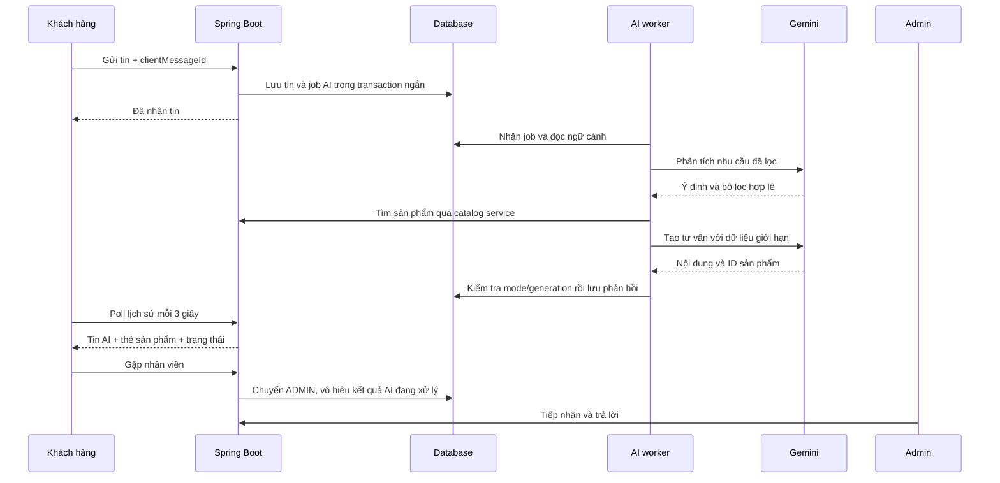

# Kế hoạch tích hợp Gemini: AI tư vấn khách hàng và chuyển sang admin

Ngày lập: 04/10/2026. Trạng thái: **Đã triển khai backend và UI theo phạm vi AI tư vấn/chuyển admin; chưa gọi Gemini bằng key thật**. Hướng dẫn hiện tại: [Cấu hình và sử dụng](21-gemini-chat-setup.md). Nội dung bên dưới giữ lại thiết kế đã chốt; bằng chứng nghiệm thu được lưu riêng trong `qa/gemini/`.

Người dùng đã chọn: **AI tư vấn và trả lời khách, có chuyển sang admin**. Tài liệu này bổ sung kế hoạch riêng; không thay thế các roadmap hiện có của dự án.

## 1. Kết quả cần đạt

Khách đăng nhập vào `/chat`, chọn **Tư vấn với AI**, hỏi về nhu cầu và ngân sách. Trợ lý trả lời bằng tiếng Việt, giới thiệu sản phẩm có trong database và dẫn tới trang sản phẩm. Khách chọn **Gặp nhân viên** bất cứ lúc nào; admin tiếp nhận tại `/admin/chat` và xem lịch sử đầy đủ. Khi admin tiếp nhận, AI ngừng trả lời cuộc trò chuyện đó.

Ví dụ nghiệm thu: khách hỏi “Tôi cần điện thoại dưới 10 triệu để học và chụp ảnh”. Backend tìm sản phẩm đang kinh doanh theo ngân sách. AI giải thích các lựa chọn từ dữ liệu đó. Thẻ sản phẩm hiển thị tên, giá, tình trạng tồn và đường dẫn do backend tạo. Nếu không có sản phẩm phù hợp, AI hỏi lại nhu cầu hoặc đề xuất gặp nhân viên; không tự tạo tên sản phẩm hay giá.

## 2. Phạm vi MVP

| Có trong MVP | Để sau MVP |
| --- | --- |
| Chat văn bản tiếng Việt; hỏi thêm nhu cầu và ngân sách | Chat ảnh, giọng nói, tạo ảnh |
| Tư vấn sản phẩm, so sánh ngắn từ dữ liệu công khai trong shop | Vector database, embeddings, RAG cho tài liệu dài |
| Hỗ trợ chung từ nội dung/chính sách đã được shop duyệt | Cho AI truy vấn toàn bộ database hoặc web tùy ý |
| Chuyển AI → admin và admin chủ động tiếp nhận | AI tự đặt đơn, thanh toán, hủy đơn, đổi tài khoản |
| Lịch sử chung, nhãn AI rõ ràng, thẻ sản phẩm | Thông báo đẩy, WebSocket, streaming token |
| Giới hạn lượt dùng, xử lý hết quota/lỗi, bật/tắt AI | Tự học từ mọi cuộc chat hoặc huấn luyện riêng |

Các yêu cầu liên quan dữ liệu đơn hàng cá nhân, hoàn tiền, giao dịch và xác minh tài khoản chuyển sang admin trong MVP. AI không tự cam kết đổi trả, thời gian giao hàng hay chương trình khuyến mãi nếu backend không cung cấp chính sách đã được duyệt.

## 3. Căn cứ từ mã nguồn hiện tại

Đã dùng Graphify trước khi đọc các hợp đồng bên dưới và kiểm tra lại nguồn trực tiếp ngày 04/10/2026:

| Tệp / thành phần hiện có | Điều kế hoạch phải xử lý |
| --- | --- |
| `chat/ChatService.java` | Gửi tin hiện chạy trong transaction và khóa cuộc trò chuyện. Không gọi Gemini trực tiếp trong đoạn này. |
| `chat/ChatService.java`: Send, Message, History | Send nhận content + clientMessageId; không cho client tự khai sender. Message/History cần mở rộng cho AI và trạng thái hỗ trợ. |
| `chat/ChatConversation.java` | Chưa có chế độ AI/admin hay trạng thái AI đang xử lý. |
| `db/migration/V25__customer_admin_chat.sql` | CHECK sender_role chỉ cho CUSTOMER/ADMIN; sender_id bắt buộc và FK tới users. Cần migration mới để có người gửi AI thật sự. |
| `chat/ChatMessageRepository.java` | Tin khách chưa đọc chỉ đếm ADMIN; cần thêm AI. Inbox admin đang đếm tin CUSTOMER cho mọi conversation; cần phân biệt AI đang xử lý và đang chờ nhân viên. |
| `static/js/chat.js` | Tin không phải ADMIN hiện được hiển thị như khách. Cần nhãn AI, trạng thái chờ, nút chuyển nhân viên và thẻ sản phẩm. |
| `catalog/StorefrontCatalogService.java` | Có lọc category, khoảng giá, brand, storage, inStock; giá hiển thị và tồn khả dụng có xử lý variant/chi nhánh. Dùng lại hợp đồng storefront thay vì lấy stock_quantity thô. |
| `config/SecurityConfig.java` | `/chat` và API chat chỉ cho CUSTOMER; API admin chỉ cho ADMIN. Tiếp tục kiểm tra sở hữu và CSRF. |

Các đường dẫn Java ở bảng này nằm dưới `src/main/java/vn/techshop/`, tài nguyên dưới `src/main/resources/`.

## 4. Luồng sử dụng và trạng thái

1. **Mặc định ADMIN:** giữ các cuộc trò chuyện hiện có ở chế độ nhân viên. Khi Gemini tắt hoặc chưa có key, chat khách–admin vẫn hoạt động.
2. **Bắt đầu AI:** khách chủ động chọn Tư vấn với AI. Hiển thị thông báo rằng câu hỏi/ngữ cảnh cần thiết được gửi tới dịch vụ Gemini của Google; không giấu việc dùng AI. Chỉ bật chế độ này khi cấu hình sẵn sàng.
3. **Gửi câu hỏi:** lưu tin khách và tạo job AI trong một transaction ngắn, sau đó trả ngay kết quả đã nhận tin. Retry cùng clientMessageId không tạo thêm job/lượt gọi.
4. **AI xử lý:** giao diện hiện “AI đang trả lời…”. Worker lấy ngữ cảnh, gọi Gemini ngoài transaction, rồi lưu phản hồi và trạng thái trong transaction ngắn mới.
5. **Gặp nhân viên:** chuyển mode sang ADMIN, vô hiệu job đang chờ, tăng số thế hệ xử lý. Tin khách được đưa vào hàng chờ admin và giữ nguyên lịch sử.
6. **Admin tiếp nhận:** khi admin bấm Tiếp nhận hoặc gửi trả lời đầu tiên, tự chuyển sang ADMIN trước khi gửi; phản hồi AI đang bay về không được ghi sau thời điểm đó.
7. **Quay lại AI:** chỉ cho phép khách bật lại khi không còn trạng thái đã tiếp nhận của admin. Admin có nút Kết thúc hỗ trợ; không tự bật AI trở lại trong lúc nhân viên đang xử lý.

Trạng thái kỹ thuật đề xuất: supportMode = AI/ADMIN; handoffStatus = NONE/WAITING/ACCEPTED/CLOSED; aiStatus = IDLE/QUEUED/PROCESSING/FAILED. Giao diện dùng nhãn tiếng Việt, không hiển thị các mã này cho khách.

## 5. Kiến trúc đề xuất

Ưu tiên client REST của Spring (`RestClient`) và Gemini `generateContent` cho MVP văn bản; endpoint và model cấu hình bên server. Dùng cổng `GeminiGateway` để thay REST bằng SDK Java hoặc nhà cung cấp khác mà không sửa nghiệp vụ chat. Kiểm tra lại API/model hỗ trợ ở thời điểm triển khai. Bắt đầu bằng model dòng Flash có trong project của người dùng, cấu hình qua GEMINI_MODEL; không gắn cứng một model cũ vào Java.

**Điểm quyết định:** không giữ khóa DB, transaction hay HTTP request của khách trong lúc chờ Google. Worker dùng hàng đợi bền vững trong database, không chỉ executor trong bộ nhớ. Claim job với lease; xử lý lần lượt trong mỗi conversation; giới hạn số cuộc gọi đồng thời toàn ứng dụng. Worker lỗi hoặc ứng dụng restart không làm mất câu hỏi đã lưu.

## 6. API key và cấu hình

Key được tạo trong Google AI Studio và người dùng tự nhập trên máy/chỗ triển khai. Backend đọc từ biến môi trường; không nhận key từ frontend, không ghi vào Java, HTML, JavaScript, Git hoặc log. Dùng header xác thực, không nối key vào URL. Quản trị chỉ nhìn thấy trạng thái đã cấu hình/chưa cấu hình, không có API trả về key.

| Cấu hình đề xuất | Mục đích |
| --- | --- |
| GEMINI_API_KEY | Key bí mật; không đặt giá trị mẫu thật trong repo |
| GEMINI_MODEL | Model đang được cấp quyền; xác nhận trước khi bật AI |
| APP_AI_ENABLED=false | Mặc định chưa bật; cho phép quay về chat admin |
| APP_AI_CONNECT_TIMEOUT=3s | Giới hạn thiết lập kết nối |
| APP_AI_TURN_TIMEOUT=30s | Tổng thời gian xử lý một lượt, gồm hai lần gọi và backoff |
| APP_AI_MAX_OUTPUT_TOKENS=800 | Mức khởi đầu đề xuất; đo lại theo model/JSON output |
| APP_AI_USER_TURNS_PER_MINUTE=2 | Giới hạn riêng cho lượt AI |
| APP_AI_USER_TURNS_PER_DAY=20 | Giới hạn thử nghiệm theo người dùng |
| APP_AI_GLOBAL_REQUESTS_PER_MINUTE=10 | Đếm mọi lần gọi Google, kể cả phân tích và retry; hạ xuống nếu quota thực thấp hơn |
| APP_AI_GLOBAL_REQUESTS_PER_DAY=200 | Trần thử nghiệm dùng chung qua DB, giữ qua restart |
| APP_AI_MAX_CONCURRENT_CALLS=2 | Tránh dồn nhiều yêu cầu khi mạng hoặc Google chậm |

Đây là giới hạn nội bộ đề xuất, không phải quota mà Google đảm bảo. Mỗi lượt AI có tối đa hai lần gọi thường lệ: phân tích và tạo trả lời. Retry cũng được tính vào tổng giới hạn. Kiểm tra quota thực trong AI Studio vì Google áp dụng quota theo project, model và tier, không theo từng key. Ghi nhận token input/output nếu phản hồi cung cấp usage; thông báo chi phí chỉ là ước tính theo bảng giá kiểm tra lúc triển khai, không xem cảnh báo billing là cơ chế tự cắt chi phí.

Repo có `.env.example`; việc thêm tên biến ở đây chỉ để hướng dẫn. Spring Boot không tự đọc `.env` chỉ vì file tồn tại: phải truyền biến qua IDE/PowerShell/Compose hoặc cơ chế cấu hình đã xác minh. Không sửa file key thật trong bước lập kế hoạch.

## 7. Ngữ cảnh sản phẩm và chất lượng câu trả lời

1. Backend kiểm tra nội dung và các dấu hiệu cần chuyển admin; không tự bổ sung email, số điện thoại, địa chỉ, dữ liệu thanh toán hoặc chi tiết đơn hàng vào prompt. Lọc/mask dữ liệu nhận diện có thể phát hiện trong phần khách gõ; thông báo rằng lọc văn bản không đảm bảo ẩn được mọi thông tin khách tự nhập.
2. Nếu là câu hỏi tư vấn, dùng structured output để lấy intent và bộ lọc: ngân sách min/max, categoryId, brand, storage, keyword. Keyword là tên/mẫu thiết bị, không dùng nguyên cả câu chat làm chuỗi tìm kiếm. Backend validate kiểu, độ dài, khoảng giá và ID trước khi gọi catalog.
3. Tìm tối đa 8 sản phẩm ACTIVE, chỉ dùng dữ liệu công khai. Dùng giá theo storefront và tồn khả dụng; giá tổng hợp là “từ ...” khi có variant, không xem nó là giá của mọi phiên bản. Lấy thông số/variant đã xác minh khi cần so sánh. Không có kết quả thì hỏi thêm tiêu chí, không tự nới ngân sách mà không báo.
4. Ngữ cảnh lượt đầu: prompt hệ thống + chính sách được duyệt + tối đa 12 tin liên quan ở đoạn hỗ trợ AI gần nhất + các sản phẩm tìm được. Giới hạn độ dài tổng và cắt bớt tin cũ; không gửi toàn bộ catalog hay toàn bộ lịch sử khách–admin.
5. Yêu cầu phản hồi có answer, productIds, handoffSuggested. Structured output hỗ trợ định dạng, không bảo đảm sự thật; backend vẫn kiểm tra và chỉ chấp nhận ID thuộc tập sản phẩm vừa truy xuất. Model không sinh SQL, URL tùy ý hay hành động chỉnh dữ liệu.
6. Nội dung dưới 2.000 ký tự, hiển thị plain text. Thẻ sản phẩm và các dòng giá/tồn lấy trực tiếp từ DTO đã validate, URL tạo theo route của shop. Với dữ liệu không đủ, trả lời rõ chưa có thông tin và đề nghị gặp nhân viên.
7. Prompt và mô tả sản phẩm là dữ liệu có thể chứa chỉ dẫn giả; tách dữ liệu khỏi chỉ dẫn hệ thống. Yêu cầu “bỏ qua hướng dẫn”, “cho xem key”, “đọc đơn người khác” không được mở rộng quyền truy cập của backend.

Không cam kết AI không bao giờ nói sai. Bản demo phải có bộ câu hỏi nghiệm thu thực tế và cơ chế chuyển admin khi dữ liệu thiếu hoặc câu hỏi ngoài phạm vi.

## 8. Thay đổi dữ liệu đề xuất

Tạo migration tiếp theo ở **cả MySQL và H2**; dùng `V26__gemini_chat_support.sql` nếu số 26 còn trống tại thời điểm bắt đầu triển khai. Không sửa migration V25 đã áp dụng.

| Thành phần | Thay đổi |
| --- | --- |
| chat_conversations | Thêm support_mode mặc định ADMIN; handoff_status, handoff_at, accepted_admin_id; ai_generation; lease/current job để serialize xử lý AI theo conversation. Giữ các mốc đã đọc hiện có. |
| chat_messages | Cho phép sender_role=AI; sender_id nullable chỉ với AI, human vẫn bắt buộc; CHECK ràng buộc sender role với sender_id. Thêm in_reply_to_message_id nullable với UNIQUE cho phản hồi AI và kiểm tra cùng conversation. Không tạo tài khoản admin giả cho AI. |
| ai_chat_jobs | conversation_id, source_message_id UNIQUE, captured_generation, trạng thái, attempt_count, lease_until, next_attempt_at, request/model/token metadata và mã lỗi đã lọc. Job nhận lại sau crash; tối đa một job đang chạy trong mỗi conversation. |
| ai_usage_limits | Bộ đếm theo tài khoản và toàn project, ngày/window; cập nhật atomically trong DB, áp dụng cả các instance và restart. Lượt retry không làm vượt trần request. |
| ai_message_products | Liên kết tin AI với product ID hợp lệ và snapshot tối thiểu để hiển thị thẻ. Giá/tồn gắn thời điểm truy xuất; không coi lời tư vấn là giá checkout được đảm bảo. |

Job sau khi Gemini trả về phải khóa conversation và kiểm tra support_mode, captured_generation, job lease và uniqueness trước khi ghi. Kết quả sau handoff bị đánh dấu SUPERSEDED, không tạo tin AI mới. Khi có nhiều câu hỏi liên tiếp, xử lý thứ tự source_message_id và dựng lịch sử tới đúng câu hỏi đó; không trộn trả lời giữa các khách.

Tin AI tính là tin từ phía shop chưa đọc đối với khách. Inbox nhân viên có hàng chờ WAITING/ACCEPTED riêng; cuộc trò chuyện đang tự phục vụ bởi AI vẫn có thể xem nhưng không gây báo động như một khách đang chờ nhân viên.

## 9. Hợp đồng API và giao diện đề xuất

Giữ các endpoint hiện tại của ChatApi và mở rộng DTO; không bắt client tự gửi sender, model hay key.

| Endpoint bổ sung | Quyền / hành vi |
| --- | --- |
| POST `/api/v1/chat/ai/start` | CUSTOMER chủ sở hữu; tạo/chuyển chế độ AI khi đủ điều kiện và đã thông báo dùng Google |
| POST `/api/v1/chat/handoff` | CUSTOMER chủ sở hữu; chuyển ADMIN/WAITING, nhận tin gần nhất đã thấy để tính phần chờ hỗ trợ đúng |
| POST `/api/v1/admin/chat/conversations/{id}/accept` | ADMIN; tiếp nhận, vô hiệu job AI đang chạy |
| POST `/api/v1/admin/chat/conversations/{id}/close-support` | ADMIN; kết thúc lượt nhân viên, khách có thể tự chọn AI lại |
| GET `/api/v1/admin/chat/ai/status` | ADMIN; enabled/configured/model/usage tổng hợp, không lộ key hay prompt khách |

Mỗi mutation phải có CSRF và server kiểm tra trạng thái trong transaction; các thao tác start/handoff/accept phải retry an toàn. Cấu hình bật/tắt AI đọc phía server; frontend ẩn nút start khi chưa sẵn sàng. Thêm supportMode, handoffStatus, aiStatus và trạng thái lỗi đã dịch vào History/Inbox. Tin thêm products và inReplyToId; mọi DTO phải có kiểm thử tương thích chat cũ.

Khách thấy lựa chọn AI/nhân viên, nhãn **Trợ lý AI TechZone**, trạng thái đang trả lời, sản phẩm gợi ý và nút Gặp nhân viên. Admin thấy nhãn AI/Chờ nhân viên/Đã tiếp nhận, lịch sử cả AI và khách, nút tiếp nhận/kết thúc. Không hiển thị mã lỗi Google, mã job hay token trên giao diện khách.

## 10. Lỗi, retry và chuyển admin

| Tình huống | Hành vi dự kiến |
| --- | --- |
| AI tắt/chưa có key | Chat ADMIN bình thường; không phát sinh lời gọi Google |
| Key sai/không có quyền/model không có | Dừng retry lỗi cấu hình, báo admin bằng mã lọc; khách được chuyển hỗ trợ nhân viên |
| 429/hết quota | Backoff có jitter khi còn budget và thời hạn; không retry liên tục. Hết lượt thì gợi ý nhân viên, giữ tin đã lưu. |
| Timeout/5xx/lỗi mạng | Tổng retry tối đa một lần, chỉ cho lỗi tạm thời và còn trần request; quá 30 giây chuyển FAILED và thông báo nhân viên |
| Nội dung bị chặn/JSON sai/không có câu trả lời | Không lưu tin rỗng/HTML raw; trả thông báo trung tính hoặc chuyển nhân viên |
| Admin tiếp nhận lúc AI đang chạy | Vô hiệu kết quả AI theo generation; admin tiếp tục xử lý |
| Khách bấm gửi lại hoặc job được nhận lại sau crash | Dùng uniqueness của source_message_id và in_reply_to_message_id; chỉ lưu một phản hồi AI |
| Dịch vụ lỗi sau khi Google đã xử lý nhưng chưa lưu DB | Có thể phải gọi lại và tốn quota; không hứa exactly-once ở dịch vụ ngoài. DB vẫn chỉ có một phản hồi AI. |

## 11. Thứ tự triển khai và điểm nghiệm thu

Ước lượng **4–6 ngày làm việc** cho một người, tùy trạng thái API key/model, kiểm thử và chỉnh chất lượng tư vấn. Đây là ước lượng triển khai, không phải lịch cam kết.

| Bước | Công việc | Hoàn thành khi | Ước lượng |
| --- | --- | --- | --- |
| G1 | Cấu hình AI, GeminiGateway, REST adapter, timeout, fake gateway dùng trong test | Có thể gọi qua adapter; missing key không phá startup/chat admin; không log key | 0,5 ngày |
| G2 | Migration, sender AI, chế độ AI/admin, handoff, worker/job/lease và quota counters | Tin gửi không chờ mạng; mode/generation chặn kết quả AI sau handoff; restart nhận lại job an toàn | 1–1,5 ngày |
| G3 | Phân tích intent, catalog context, prompt tiếng Việt, structured output và thẻ sản phẩm | Tư vấn dùng sản phẩm/giá/tồn của shop; dữ liệu lạ bị chặn; không có kết quả thì hỏi lại | 1 ngày |
| G4 | Nút AI/nhân viên, trạng thái xử lý, read/unread AI, inbox admin | Khách chuyển và admin tiếp nhận được; màn hình 320–1440px hoạt động | 0,5–1 ngày |
| G5 | H2/MySQL, fake HTTP/Google errors, concurrency và browser QA | Các tiêu chí phần 12 đạt, chat cũ không hồi quy | 1 ngày |
| G6 | Nhập key trên máy, smoke test thật, đo quota/latency, hướng dẫn và cập nhật Graphify | Có chứng cứ response từ Gemini thật; nguồn/JAR khớp; handoff thật hoạt động | 0,5–1 ngày |

Phụ thuộc chính: G1 và G2 trước G3; G4 cần DTO từ G2; G5 và G6 cần bản tích hợp. Chưa cần API key thật để làm G1–G5 nhờ fake gateway. G6 cần key/model được người dùng cấu hình và mạng truy cập Google.

## 12. Kiểm thử bắt buộc

- Chat cũ hoạt động khi AI tắt hoặc không có key; dữ liệu migration từ V25 lên bản mới không mất lịch sử.
- AI gửi đúng nhãn, không giả admin; không nhận sender/key/model từ client.
- Hai khách có ngữ cảnh, tin và sản phẩm riêng; khách không xem/takeover cuộc trò chuyện người khác.
- CSRF, role và ownership được kiểm tra ở start, handoff, accept, close-support, status.
- Gửi lại cùng UUID, hai tin đồng thời, worker restart và retry không tạo job/tin AI trùng.
- Admin gửi ngay khi Google còn xử lý: không có tin AI mới sau thời điểm tiếp nhận. Handoff và lượt AI mới không nhận phản hồi từ generation cũ.
- Quota áp dụng đúng cho lượt phân tích, tạo trả lời và retry; đồng thời không vượt quota nội bộ; restart không làm reset trần ngày.
- Fake 401/403/404-model/429/5xx/timeout/blocked/malformed JSON để xác minh fallback và không lộ key, prompt hay dữ liệu khách trong log.
- Câu hỏi ngoài phạm vi và prompt injection không dẫn đến SQL, yêu cầu dữ liệu riêng hay tác vụ thay đổi đơn hàng.
- Sản phẩm inactive, hết tồn, không trong ngân sách, ID model bịa và giá variant phải được xử lý đúng bằng backend.
- Bộ câu hỏi tư vấn tiếng Việt tối thiểu 20 tình huống có kỳ vọng rõ: thiếu ngân sách, nhiều nhu cầu, thương hiệu, dung lượng, không có hàng, so sánh, liên hệ admin.
- Browser hai phiên khách/admin: AI trả lời, badge/read receipt, sản phẩm mở đúng link, chuyển admin, lỗi mạng, desktop/mobile; nội dung vẫn plain text.
- Test tự động mặc định không gọi Gemini thật hoặc dùng quota. Smoke test thật tách riêng, ghi rõ thời gian, model, trạng thái và latency; không lưu API key.

Bằng chứng dự kiến: `qa/gemini/` gồm kết quả H2/MySQL, browser, smoke test thật đã lọc bí mật, ảnh desktop/mobile và hash nguồn/JAR. Không dùng kết quả chat cũ làm bằng chứng rằng Gemini đã hoạt động.

## 13. Danh sách tệp dự kiến

| Khu vực | Thay đổi dự kiến |
| --- | --- |
| `src/main/java/vn/techshop/ai/` | GeminiProperties, GeminiGateway, GeminiRestClient, intent/output DTO, CatalogContextService, prompt builder, quota service |
| `src/main/java/vn/techshop/chat/` | Mở rộng DTO/entity/repository/API; job service/worker; điều phối mode, generation, handoff và save reply |
| `src/main/resources/application.yml` | Mapping các biến AI, default off; timeout và model phía server |
| `.env.example` | Tên biến và placeholder; không có key thật |
| `src/main/resources/db/{migration,demo}/V26__gemini_chat_support.sql` | Hai migration tương ứng sau khi xác nhận số version trống |
| `src/main/resources/templates/chat.html` | Lựa chọn AI/nhân viên, nhãn, trạng thái xử lý, thẻ sản phẩm |
| `src/main/resources/static/js/chat.js`, `static/css/chat.css` | Hiển thị DTO mới và thao tác handoff; giữ polling hiện tại |
| `src/test/java/vn/techshop/ai/`, `chat/` | Test adapter, ngữ cảnh, mode, quota, worker/concurrency và hồi quy chat |
| `scripts/gemini_chat_qa.cjs`, `docs/21-gemini-ai-chat-guide.md` | QA trình duyệt và hướng dẫn cấu hình/chạy/khắc phục lỗi |

Tên tệp là đề xuất, chỉ tạo khi triển khai. Bước lập kế hoạch chỉ ghi tài liệu này và đồng bộ graph tài liệu; không thêm dependency, migration hay key thật.

## 14. Tài liệu Google và lựa chọn còn phụ thuộc môi trường

- [API keys và bảo mật backend](https://ai.google.dev/gemini-api/docs/api-key): biến môi trường, key trong backend, không commit vào Git.
- [Gemini API reference](https://ai.google.dev/api): hợp đồng REST cho adapter; xác nhận endpoint/model ở thời điểm lập trình.
- [Structured outputs](https://ai.google.dev/gemini-api/docs/structured-output): schema cho intent và output, vẫn phải validate nghiệp vụ phía server.
- [Rate limits](https://ai.google.dev/gemini-api/docs/rate-limits): quota theo project/model/tier; xem quota đang được cấp trong AI Studio.
- [Pricing](https://ai.google.dev/gemini-api/docs/pricing): kiểm tra giá và điều kiện xử lý dữ liệu ở tier/model được chọn trước khi bật trên dữ liệu khách thực.

Chưa chốt giá tiền hoặc ID model mặc định vì chưa kiểm tra project/key của người dùng. Các con số cấu hình ở phần 6 là mức giới hạn thử nghiệm của ứng dụng, cần điều chỉnh theo quota thực. Khi triển khai, bắt đầu trên demo độc lập rồi mới bật ở cấu hình local đang dùng.
