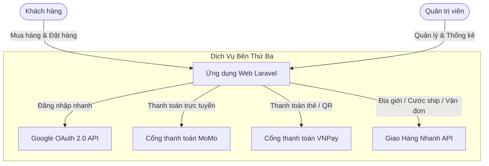

> Tài liệu tham chiếu Laravel được cung cấp trước khi mở rộng Spring Boot. Không xác nhận các tính năng/thư viện dưới đây tồn tại trong repo này.

# TÀI LIỆU TỔNG HỢP CÁC CHỨC NĂNG CỦA DỰ ÁN (PROJECT FEATURES SPECIFICATION)

> **Tên dự án:** Website Bán hàng Trực tuyến (E-Commerce Web Application)  
> **Nền tảng:** Laravel Framework 12.x | PHP 8.2+ | MySQL  
> **Kiến trúc:** Mô hình MVC (Model - View - Controller), Kiến trúc Service Layer, RESTful Routing  
> **Ngày cập nhật:** Tháng 10/2026  

---

## MỤC LỤC
1. [Tổng quan hệ thống](#1-tổng-quan-hệ-thống)
2. [Phân quyền & Đối tượng người dùng](#2-phân-quyền--đối-tượng-người-dùng)
3. [Phân hệ Khách hàng (Client / Frontend)](#3-phân-hệ-khách-hàng-client--frontend)
4. [Phân hệ Quản trị (Admin Panel / Backend)](#4-phân-hệ-quản-trị-admin-panel--backend)
5. [Tích hợp dịch vụ bên thứ ba (Third-party Integrations)](#5-tích-hợp-dịch-vụ-bên-thứ-ba-third-party-integrations)
6. [Bảng ánh xạ luồng Routes & Controllers](#6-bảng-ánh-xạ-luồng-routes--controllers)
7. [Bảo mật & Cơ chế an toàn dữ liệu](#7-bảo-mật--cơ-chế-an-toàn-dữ-liệu)
8. [Hệ thống Hiệu ứng Chuyển động (Animations) & Hướng dẫn Clone](#8-hệ-thống-hiệu-ứng-chuyển-động-animations--hướng-dẫn-clone)

---

## 1. TỔNG QUAN HỆ THỐNG

Dự án là nền tảng thương mại điện tử hoàn chỉnh phục vụ kinh doanh trực tuyến, hỗ trợ mua sắm đa kênh từ duyệt sản phẩm, đặt hàng, tự động tính cước vận chuyển theo vị trí địa lý, tích hợp thanh toán online và quản trị đơn hàng, xuất báo cáo chuyên nghiệp.

### Các công nghệ & thư viện nòng cốt:
- **Backend:** [Laravel](https://laravel.com) 12.x, Eloquent ORM, Service Pattern (`CartService`, `OrderService`, `GHNService`, `MoMoService`, `VNPayService`).
- **Database:** MySQL (InnoDB, hỗ trợ đầy đủ khóa ngoại, transactions và migrations).
- **Frontend Client:** Blade Template Engine, Bootstrap 5.3, FontAwesome, Owl Carousel, SweetAlert2, AJAX (XHR / Fetch).
- **Frontend Admin:** Quixlab Admin Dashboard Theme, Bootstrap 4, DataTables, MetisMenu, Chart.js.
- **Tích hợp mở rộng:** Cổng thanh toán MoMo, VNPay, Giao Hàng Nhanh (GHN Open API), Google OAuth 2.0.

---

## 2. PHÂN QUYỀN & ĐỐI TƯỢNG NGƯỜI DÙNG

Hệ thống được thiết kế với 3 nhóm vai trò rõ ràng:

| Vai trò | Mô tả | Quyền hạn chính |
| :--- | :--- | :--- |
| **Khách vãng lai (Guest)** | Người dùng chưa đăng nhập tài khoản | Duyệt sản phẩm, tìm kiếm, xem đánh giá, thêm giỏ hàng tạm, tra cứu đơn hàng công khai theo mã. |
| **Khách hàng (Customer / User)** | Người dùng đã đăng ký tài khoản | Quản lý thông tin cá nhân, lưu giỏ hàng trong DB, đặt hàng, áp dụng coupon, chọn cổng thanh toán, xem lịch sử đơn hàng cá nhân, tự hủy đơn hợp lệ, đánh giá sản phẩm. |
| **Quản trị viên (Admin)** | Ban quản lý hệ thống | Truy cập trang Admin Dashboard, xem báo cáo doanh thu, xuất file Excel/PDF, quản lý sản phẩm, danh mục, thương hiệu, coupon, duyệt đơn hàng, đẩy vận đơn GHN, duyệt đánh giá, phân quyền tài khoản. |

---

## 3. PHÂN HỆ KHÁCH HÀNG (CLIENT / FRONTEND)

### 3.1. Xác thực & Quản lý Tài khoản (Authentication & Profile)
- **Đăng ký tài khoản:** Khách hàng đăng ký tài khoản mới qua form với xác thực dữ liệu đầu vào (tên, email, số điện thoại, mật khẩu mã hóa bcrypt).
- **Đăng nhập truyền thống:** Đăng nhập an toàn qua email và mật khẩu.
- **Đăng nhập mạng xã hội (Google OAuth 2.0):**
  - Tích hợp qua Laravel Socialite.
  - Tự động liên kết tài khoản Google với tài khoản người dùng trong cơ sở dữ liệu (`google_id`, `google_avatar`).
- **Quên mật khẩu & Khôi phục (Password Reset):**
  - Gửi link xác nhận đặt lại mật khẩu an toàn qua Email có gắn mã token xác thực có thời hạn.
  - Cho phép người dùng nhập mật khẩu mới sau khi xác thực token.
- **Trang hồ sơ cá nhân:** Xem và cập nhật thông tin tài khoản người dùng (`/show-profile`).
- **Đăng xuất an toàn:** Hủy phiên làm việc và bảo vệ session.

### 3.2. Khám phá & Tìm kiếm sản phẩm (Discovery & Search)
- **Trang chủ (Home Page):**
  - Banner quảng cáo và slider sự kiện khuyến mãi nổi bật.
  - Danh sách sản phẩm mới nhất, sản phẩm bán chạy, sản phẩm theo danh mục và thương hiệu.
- **Điều hướng theo Danh mục & Thương hiệu:**
  - Lọc sản phẩm theo danh mục (`/show-product-category-home/{id}`).
  - Lọc sản phẩm theo thương hiệu yêu thích.
- **Tìm kiếm thông minh (Search & Autocomplete):**
  - Tìm kiếm sản phẩm theo tên và từ khóa (`/search`).
  - Gợi ý từ khóa tự động thời gian thực bằng AJAX (`/autocomplete-ajax`).
  - Lưu và phân tích lịch sử tìm kiếm người dùng (`history_searches`).

### 3.3. Xem chi tiết & Đánh giá sản phẩm (Product Details & Reviews)
- **Trang chi tiết sản phẩm:**
  - Hiển thị album ảnh sản phẩm, tên, mô tả chi tiết, giá gốc và giá khuyến mãi.
  - Hiển thị tình trạng tồn kho, mã sản phẩm (SKU).
  - Lựa chọn phiên bản, màu sắc hoặc kích cỡ sản phẩm (`variants` & `colors`).
- **Hệ thống đánh giá & Bình luận (Product Reviews):**
  - Khách hàng đã mua có thể chấm điểm theo số sao (1 đến 5 sao).
  - Viết nhận xét chi tiết kèm cảm nhận.
  - Đánh giá được đưa vào hàng đợi kiểm duyệt trước khi hiển thị công khai để ngăn ngừa nội dung độc hại.

### 3.4. Quản lý Giỏ hàng (Cart Management)
- **Thêm sản phẩm vào giỏ hàng:** Xử lý bằng AJAX không cần tải lại trang, phản hồi thông báo tức thời (Toast/Alert).
- **Xem giỏ hàng chi tiết:**
  - Liệt kê đầy đủ các mặt hàng, hình ảnh đại diện, đơn giá, số lượng và tổng tiền tạm tính.
  - Cập nhật số lượng sản phẩm trực tiếp với kiểm tra tồn kho tức thì.
  - Xóa từng món hàng hoặc dọn sạch toàn bộ giỏ hàng (`clear cart`).
- **Tóm tắt giỏ hàng (Cart Summary API):** Cung cấp API tính toán nhanh số lượng và số tiền giỏ hàng hiển thị trên Header.
- **Áp dụng Mã giảm giá (Coupon / Voucher):**
  - Nhập mã ưu đãi giảm giá (`/check-coupon`).
  - Kiểm tra tính hợp lệ: thời hạn, số lượt dùng còn lại, mức giảm (theo phần trăm `%` hoặc số tiền cố định `VNĐ`).
  - Cho phép hủy áp dụng mã giảm giá khi đổi ý (`/remove-coupon`).

### 3.5. Quy trình Đặt hàng & Vận chuyển (Checkout & Shipping)
- **Nhập thông tin nhận hàng:**
  - Họ tên người nhận, số điện thoại, email liên hệ, ghi chú đơn hàng.
  - Địa chỉ nhận hàng chi tiết.
- **Tích hợp Tự động hóa Vận chuyển (Giao Hàng Nhanh - GHN API):**
  - Chọn Tỉnh/Thành phố -> tự động tải danh sách Quận/Huyện -> tự động tải danh sách Phường/Xã (`/locations/*` và `/ghn/*`).
  - Tính phí giao hàng chính xác theo API GHN dựa trên địa điểm nhận hàng và trọng lượng đơn hàng.
  - Hỗ trợ định vị ngược (Reverse Geocoding) lấy tọa độ kinh độ/vĩ độ để tối ưu tuyến giao hàng.
- **Tổng kết chi phí minh bạch:** Hiển thị rõ tổng tiền hàng, số tiền giảm giá từ coupon, phí vận chuyển và tổng tiền thanh toán cuối cùng.

### 3.6. Cổng Thanh toán Đa phương thức (Payment Gateways)
- **1. Thanh toán khi nhận hàng (COD):** Xác nhận đơn hàng ngay và thanh toán tiền mặt lúc giao hàng.
- **2. Cổng thanh toán MoMo:**
  - Chuyển hướng đến cổng thanh toán MoMo (hỗ trợ quét mã QR hoặc thẻ ngân hàng).
  - Tích hợp Webhook IPN (`/momo-ipn`) tự động xử lý kết quả giao dịch ngầm.
  - Trang điều hướng trả về (`/momo-return`) sau khi khách hoàn tất thanh toán.
  - Chế độ Mock Payment (`/momo/mock-pay/{order_id}`) hỗ trợ kiểm thử tiện lợi.
- **3. Cổng thanh toán VNPay:**
  - Tích hợp cổng VNPay với thuật toán ký checksum bảo mật (HMAC SHA512).
  - Hỗ trợ thanh toán qua ứng dụng ngân hàng (VNPAY-QR) và thẻ ATM/nội địa/quốc tế.
  - Nhận và xử lý phản hồi tức thì qua Return URL (`/vnpay-return`) và IPN URL (`/vnpay-ipn`).
- **Ghi nhật ký giao dịch (Payment Transactions):** Lưu vết toàn bộ mã giao dịch, số tiền, ngân hàng, mã phản hồi từ cổng thanh toán để đối soát.

### 3.7. Theo dõi & Quản lý Đơn hàng (Order Tracking)
- **Trang cảm ơn / Đặt hàng thành công:** Hiển thị thông tin mã đơn, trạng thái thanh toán và hướng dẫn tiếp theo (`/dat-hang-thanh-cong/{id}`).
- **Thanh toán lại (Repay):** Hỗ trợ khách hàng thử lại phương thức thanh toán nếu giao dịch online bị gián đoạn hoặc thất bại (`/orders/{id}/repay`).
- **Quản lý đơn hàng cá nhân (`/my-orders`):**
  - Liệt kê toàn bộ lịch sử mua hàng kèm trạng thái: Chờ xử lý, Đang xử lý, Đang giao hàng, Hoàn thành, Đã hủy.
  - Xem chi tiết từng đơn hàng (`/orders/{id}`).
  - Cho phép người dùng tự bấm Hủy đơn hàng đối với các đơn chưa được xử lý/giao đi (`/orders/{id}/cancel`).
- **Tra cứu đơn hàng công khai (`/tra-cuu-don-hang`):**
  - Tính năng dành cho khách mua hàng vãng lai hoặc không tiện đăng nhập.
  - Tra cứu nhanh bằng cách nhập **Mã đơn hàng** kết hợp **Số điện thoại** hoặc **Email**.

---

## 4. PHÂN HỆ QUẢN TRỊ (ADMIN PANEL / BACKEND)

Truy cập an toàn qua URL prefix `/admin` được bảo vệ bởi 2 lớp Middleware: `auth` (đã đăng nhập) và `admin` (phải có vai trò quản trị viên).

### 4.1. Bảng điều khiển & Báo cáo thống kê (Dashboard & Analytics)
- **Thống kê tổng quan:**
  - Tổng doanh thu theo ngày, tháng, năm.
  - Số lượng đơn hàng mới, đơn hàng thành công, đơn hàng bị hủy.
  - Tổng số khách hàng đăng ký và số lượng sản phẩm đang hoạt động.
- **Biểu đồ trực quan:** Biểu đồ doanh thu theo chu kỳ thời gian và xu hướng tăng trưởng.
- **Xuất báo cáo đa định dạng:**
  - Xuất báo cáo danh sách đơn hàng sang định dạng **Excel (`.xlsx`)** phục vụ kế toán.
  - Xuất báo cáo đơn hàng sang định dạng **PDF (`.pdf`)** để in ấn hoặc lưu trữ.

### 4.2. Quản lý Sản phẩm (Products Management)
- **Danh sách sản phẩm:** Bảng phân trang hiển thị ảnh, tên sản phẩm, danh mục, thương hiệu, đơn giá, tồn kho và trạng thái.
- **Thêm sản phẩm mới:**
  - Nhập tên, slug tự động, giá niêm yết, giá khuyến mãi.
  - Chọn danh mục sản phẩm và thương hiệu.
  - Tải lên hình ảnh đại diện sản phẩm (hỗ trợ lưu trữ thư mục `public/uploads`).
  - Nhập mô tả tóm tắt và nội dung giới thiệu chi tiết.
  - Thiết lập thuộc tính biến thể, kích cỡ, màu sắc và số lượng tồn kho ban đầu.
- **Cập nhật sản phẩm:** Chỉnh sửa thông tin, giá bán, số lượng tồn kho, thay thế ảnh mới.
- **Xóa sản phẩm:** Hỗ trợ xóa sản phẩm với cơ chế bảo toàn ràng buộc đơn hàng.

### 4.3. Quản lý Danh mục (Category Management)
- **Danh sách danh mục:** Quản lý cây phân loại sản phẩm.
- **Thao tác nghiệp vụ:**
  - Thêm danh mục mới.
  - Chỉnh sửa tên danh mục, mô tả.
  - Bật/tắt trạng thái hiển thị danh mục trên menu khách hàng.
  - Xóa danh mục kèm cơ chế cảnh báo ràng buộc sản phẩm liên quan.

### 4.4. Quản lý Thương hiệu (Brand Management)
- **Danh sách thương hiệu:** Quản lý các đối tác sản xuất, nhãn hàng cung ứng.
- **Thao tác:** Thêm mới thương hiệu, cập nhật thông tin/mô tả, chuyển đổi trạng thái hiển thị hoặc xóa thương hiệu.

### 4.5. Quản lý Đơn hàng & Vận hành (Order Management)
- **Danh sách đơn hàng toàn hệ thống:** Lọc đơn theo trạng thái (Mới đặt, Đã xác nhận, Đang vận chuyển, Đã giao thành công, Hủy đơn).
- **Xem chi tiết đơn hàng:**
  - Xem thông tin người đặt và người nhận hàng.
  - Chi tiết danh sách sản phẩm, số lượng, đơn giá, mã giảm giá áp dụng, phí ship GHN.
  - Lịch sử phương thức thanh toán và trạng thái thanh toán (Chưa thanh toán / Đã thanh toán qua MoMo, VNPay, COD).
- **Cập nhật trạng thái đơn:** Thay đổi trạng thái vận hành theo quy trình xử lý đơn thực tế.
- **Hủy đơn hàng:** Quyền hủy đơn từ phía admin kèm lý do hủy.
- **Đẩy đơn vận chuyển tự động sang GHN (`Push to GHN`):**
  - Nút bấm trực tiếp đẩy thông tin đơn hàng sang hệ thống Giao Hàng Nhanh qua API.
  - Tự động nhận mã vận đơn GHN (`ghn_order_code`) để theo dõi hành trình giao nhận.
- **Xóa đơn hàng:** Xóa các đơn rác hoặc đơn thử nghiệm khỏi hệ thống.

### 4.6. Quản lý Mã giảm giá (Coupon / Voucher Management)
- **Danh sách mã ưu đãi:** Theo dõi toàn bộ các chiến dịch khuyến mãi đang diễn ra hoặc đã kết thúc.
- **Tạo mã giảm giá mới:**
  - Nhập mã coupon (Ví dụ: `SALE50K`, `TRIAN10`).
  - Chọn kiểu giảm: Giảm theo phần trăm (`%`) hoặc Giảm trừ tiền mặt trực tiếp (`VNĐ`).
  - Cấu hình số lượng mã được phép sử dụng.
  - Cấu hình ngày bắt đầu và ngày hết hạn.
- **Cập nhật & Xóa mã:** Điều chỉnh thông tin hoặc thu hồi mã khuyến mãi bất cứ lúc nào.

### 4.7. Quản lý Người dùng & Phân quyền (Users & Roles Management)
- **Danh sách thành viên:** Hiển thị toàn bộ người dùng trong hệ thống (Tên, Email, SĐT, Ngày đăng ký, Vai trò).
- **Phân quyền người dùng:** Cấp quyền quản trị (`role = admin`) hoặc hạ quyền về người dùng thông thường (`role = user`).
- **Xóa tài khoản:** Quản lý và xử lý các tài khoản vi phạm chính sách hoặc rác.

### 4.8. Quản lý Đánh giá & Phản hồi (Product Reviews Moderation)
- **Danh sách đánh giá:** Hiển thị các bài đánh giá, điểm sao và phản hồi từ khách hàng.
- **Kiểm duyệt nội dung:** Phê duyệt (Hiển thị) hoặc Ẩn/Từ chối đánh giá chứa ngôn từ không phù hợp trước khi xuất hiện trên trang sản phẩm.

---

## 5. TÍCH HỢP DỊCH VỤ BÊN THỨ BA (THIRD-PARTY INTEGRATIONS)



1. **Google OAuth 2.0 (Socialite):**
   - Đăng nhập một chạm không cần gõ mật khẩu.
   - Đồng bộ email và avatar từ tài khoản Google.
2. **Cổng thanh toán điện tử MoMo:**
   - Hỗ trợ thanh toán QR Code và thẻ tín dụng qua MoMo Payment Gateway.
   - Xử lý xác thực phản hồi chữ ký số ngầm (IPN Server-to-Server).
3. **Cổng thanh toán VNPay:**
   - Tích hợp chuẩn giao thức bảo mật của VNPay Gateway.
   - Hỗ trợ thanh toán ứng dụng ngân hàng qua VNPAY-QR và thẻ ATM nội địa.
4. **Hệ thống Giao Hàng Nhanh (GHN Open API):**
   - Lấy danh mục Tỉnh / Quận / Phường chuẩn quốc gia từ GHN.
   - Tự động tính cước vận chuyển theo khoảng cách địa lý và thông số gói hàng.
   - Tạo vận đơn trực tiếp đẩy dữ liệu sang đơn vị vận chuyển GHN.

---

## 6. BẢNG ÁNH XẠ LUỒNG ROUTES & CONTROLLERS

| Phân hệ | Phương thức | Đường dẫn (Route URI) | Controller & Action | Mục đích |
| :--- | :--- | :--- | :--- | :--- |
| **Trang chủ** | `GET` | `/` | `HomeController@show_home` | Trang chủ hiển thị banner, sản phẩm nổi bật |
| | `GET` | `/product/{id}` | `HomeController@show_product_detail` | Chi tiết sản phẩm & form đánh giá |
| | `POST` | `/product/{id}/review` | `HomeController@store_product_review` | Gửi đánh giá sao & bình luận sản phẩm |
| | `GET` | `/search` | `ProductController@search` | Tìm kiếm sản phẩm theo từ khóa |
| | `GET` | `/autocomplete-ajax` | `ProductController@autocomplete_ajax` | Gợi ý sản phẩm tự động khi gõ |
| **Xác thực** | `GET` / `POST` | `/login` | `AdminController@login` / `submit_login` | Giao diện và xử lý đăng nhập |
| | `GET` / `POST` | `/register` | `AdminController@register_admin` / `submit_register` | Giao diện và xử lý đăng ký |
| | `GET` | `/logout-admin` | `AdminController@logout_admin` | Đăng xuất phiên làm việc |
| | `GET` | `/auth/google` | `GoogleAuthController@redirectToGoogle` | Chuyển hướng đăng nhập Google |
| | `GET` | `/auth/google/callback`| `GoogleAuthController@handleGoogleCallback`| Xử lý đăng nhập Google Callback |
| | `GET` / `POST` | `/password/reset` | `PasswordResetController` | Quy trình cấp lại mật khẩu qua email |
| **Giỏ hàng** | `GET` | `/show-cart` | `CartController@show_cart` | Xem trang giỏ hàng |
| | `POST` | `/cart/add` | `CartController@addToCart` | Thêm sản phẩm vào giỏ (AJAX) |
| | `PUT` | `/cart/update/{id}` | `CartController@updateCartItem` | Cập nhật số lượng mặt hàng trong giỏ |
| | `DELETE` | `/cart/remove/{id}` | `CartController@removeFromCart` | Xóa mặt hàng khỏi giỏ |
| | `POST` | `/check-coupon` | `CartController@checkCoupon` | Kiểm tra và áp dụng mã giảm giá |
| **Thanh toán** | `GET` | `/show-checkout` | `CheckoutController@show_checkout` | Giao diện thanh toán đơn hàng |
| | `POST` | `/thanh-toan`, `/dat-hang` | `OrderController@placeOrder` | Xử lý tạo đơn hàng từ giỏ hàng |
| | `GET` | `/dat-hang-thanh-cong/{id}`| `OrderController@showSuccess` | Trang thông báo đặt hàng thành công |
| | `GET` | `/orders/{id}/repay` | `OrderController@repay` | Thanh toán lại đơn hàng |
| | `GET` / `POST` | `/momo-return`, `/momo-ipn` | `OrderController@momoReturn`, `momoIpn` | Xử lý phản hồi thanh toán MoMo |
| | `GET` / `POST` | `/vnpay-return`, `/vnpay-ipn`| `OrderController@vnpayReturn`, `vnpayIpn`| Xử lý phản hồi thanh toán VNPay |
| **Đơn hàng User**| `GET` | `/my-orders` | `OrderController@myOrders` | Danh sách đơn hàng của khách hàng |
| | `GET` | `/orders/{id}` | `OrderController@show` | Chi tiết đơn hàng của khách hàng |
| | `POST` | `/orders/{id}/cancel` | `OrderController@userCancel` | Khách hàng tự hủy đơn hàng |
| | `GET` / `POST` | `/tra-cuu-don-hang` | `OrderController@showLookupForm` / `processLookup` | Khách vãng lai tra cứu đơn hàng |
| **Admin Dashboard**| `GET` | `/admin/dashboard` | `Admin\ReportController@index` | Thống kê số liệu, biểu đồ doanh thu |
| | `GET` | `/admin/reports/orders/{fmt}`| `Admin\ReportController@export` | Xuất báo cáo đơn hàng (xlsx, pdf) |
| **Admin Quản lý**| `GET` / `POST` | `/show-product`, `/create-product` | `ProductController` | Quản lý sản phẩm |
| | `GET` / `POST` | `/show-category`, `/create-category`| `CategoryController` | Quản lý danh mục |
| | `GET` / `POST` | `/show-brand`, `/create-brand` | `BrandController` | Quản lý thương hiệu |
| | `GET` / `POST` | `/admin/orders`, `/admin/orders/{id}/status`| `Admin\OrderController` | Quản lý & duyệt đơn hàng |
| | `POST` | `/admin/orders/{id}/push-ghn` | `Admin\OrderController@pushGhn` | Đẩy đơn vận chuyển sang GHN |
| | `GET` / `POST` | `/show-coupon`, `/save` | `CouponController` | Quản lý mã khuyến mãi |
| | `GET` / `POST` | `/admin/users`, `/admin/users/{id}/role` | `AdminController` | Quản lý người dùng & phân quyền |
| | `GET` / `PATCH`| `/admin/reviews`, `/admin/reviews/{id}` | `Admin\ReviewController` | Quản lý và kiểm duyệt đánh giá |

---

## 7. BẢO MẬT & CƠ CHẾ AN TOÀN DỮ LIỆU

- **Bảo vệ xác thực (Authentication & Middleware):** Áp dụng middleware đa tầng tách biệt khu vực khách hàng (`auth`) và khu vực quản trị (`admin`), ngăn chặn triệt để tình trạng leo thang đặc quyền (Privilege Escalation).
- **Phòng chống CSRF (Cross-Site Request Forgery):** Toàn bộ các thao tác `POST`, `PUT`, `DELETE` đều được bảo vệ bằng `@csrf` token hợp lệ của Laravel.
- **Phòng chống SQL Injection:** Sử dụng Eloquent ORM và PDO Parameter Binding trong 100% các câu truy vấn cơ sở dữ liệu.
- **Bảo mật mật khẩu:** Băm mật khẩu người dùng bằng giải thuật Bcrypt với độ phức tạp cao (`Hash::make`).
- **An toàn giao dịch tài chính (Transactions Integrity):** Toàn bộ quy trình đặt hàng, trừ tồn kho và cập nhật thanh toán được bọc trong `DB::transaction()` để đảm bảo tính toàn vẹn dữ liệu (ACID).
- **Kiểm thử tự động hóa (Automated Testing Suite):**
  - `CartServiceTest`: Kiểm thử tính đúng đắn của logic tính toán giỏ hàng.
  - `AdminOrderManagementTest`: Kiểm thử luồng xử lý đơn hàng và trạng thái admin.
  - `ReportsAndReviewsTest`: Kiểm thử trích xuất báo cáo và đánh giá sản phẩm.
  - `FullFlowTest`: Kiểm thử luồng đi hoàn chỉnh từ chọn sản phẩm đến khi đặt hàng thành công.

---

## 8. HỆ THỐNG HIỆU ỨNG CHUYỂN ĐỘNG (ANIMATIONS) & HƯỚNG DẪN CLONE

Hệ thống giao diện trang chủ sở hữu chuỗi hiệu ứng chuyển động đa tầng tạo cảm giác mượt mà và trực quan cho người mua hàng.

### 8.1. Các tầng hiệu ứng đang hoạt động trên Trang chủ
1. **Hiệu ứng xuất hiện khi cuộn trang (Scroll Reveal):** 
   - Sử dụng thư viện **WOW.js** (`client/lib/wow/wow.min.js`) kết hợp cùng **Animate.css** (`client/lib/animate/animate.min.css`).
   - Các class kích hoạt: `wow fadeInLeft`, `wow fadeInRight`, `wow fadeInUp`, `wow fadeInDown`.
   - Thuộc tính trễ: `data-wow-delay="0.1s"`, `0.3s`, `0.5s`... tạo hiệu ứng so le (staggered animation).
2. **Hiệu ứng trượt Banner & Danh sách sản phẩm (Carousels / Sliders):**
   - Sử dụng **Owl Carousel 2** (`client/lib/owlcarousel/owl.carousel.min.js`).
   - Cấu hình banner chính (`.header-carousel`): Trượt tự động (`autoplay: true`), chuyển cảnh mượt (`smartSpeed: 2000ms`), lặp vô tận (`loop: true`).
   - Cấu hình danh mục và danh sách sản phẩm (`.productList-carousel`, `.productImg-carousel`): Tự động co giãn số cột theo kích thước màn hình responsive (`0px: 1 cột`, `768px: 2 cột`, `1200px: 3 - 4 cột`).
3. **Hiệu ứng điều hướng và cuộn trang (Interactive Controls):**
   - **Sticky Navbar:** Tự động bắt tọa độ cuộn chuột (`scrollTop > 45px`) để ghim thanh điều hướng lên trên cùng màn hình kèm hiệu ứng đổ bóng `shadow-sm`.
   - **Back-to-top button:** Tự động làm mờ/hiện dần (`fadeIn/fadeOut`) khi cuộn quá 300px, cuộn ngược lên đầu trang với gia tốc mượt mà (`swing`, thời gian 800ms).
   - **Live search dropdown:** Tự động `fadeIn()` danh sách kết quả gợi ý khi gõ ký tự và `fadeOut()` khi click ra ngoài.
4. **Hiệu ứng tương tác người dùng (Micro-interactions):**
   - Chuyển màu và phóng to nhẹ khi di chuột vào sản phẩm (`transform: scale(1.05)`, `transition: 0.5s`).
   - Nút bấm bo tròn (`.btn`) với `transition: 0.4s - 0.5s`.
   - Màn hình tải trang (Spinner) chuyển đổi trạng thái ẩn hiện mượt (`transition: opacity .5s ease-out`).

---

### 8.2. Hướng dẫn chi tiết cách Clone hiệu ứng sang trang / dự án khác

#### Bước 1: Nhúng các tệp thư viện CSS & JS
Đặt trong thẻ `<head>`:
```html
<!-- Animate.css -->
<link rel="stylesheet" href="https://cdnjs.cloudflare.com/ajax/libs/animate.css/4.1.1/animate.min.css"/>
<!-- Owl Carousel CSS -->
<link rel="stylesheet" href="https://cdnjs.cloudflare.com/ajax/libs/OwlCarousel2/2.3.4/assets/owl.carousel.min.css"/>
<link rel="stylesheet" href="https://cdnjs.cloudflare.com/ajax/libs/OwlCarousel2/2.3.4/assets/owl.theme.default.min.css"/>
```

Đặt trước thẻ đóng `</body>`:
```html
<!-- jQuery & Bootstrap Bundle -->
<script src="https://ajax.googleapis.com/ajax/libs/jquery/3.6.4/jquery.min.js"></script>
<script src="https://cdn.jsdelivr.net/npm/bootstrap@5.0.0/dist/js/bootstrap.bundle.min.js"></script>
<!-- WOW.js & Owl Carousel JS -->
<script src="https://cdnjs.cloudflare.com/ajax/libs/wow/1.1.2/wow.min.js"></script>
<script src="https://cdnjs.cloudflare.com/ajax/libs/OwlCarousel2/2.3.4/owl.carousel.min.js"></script>
```

#### Bước 2: Khai báo cấu trúc HTML mẫu
```html
<!-- 1. Hero Banner Slider -->
<div class="header-carousel owl-carousel">
    <div class="row g-0 align-items-center">
        <!-- Ảnh bay từ trái sang -->
        <div class="col-md-6 wow fadeInLeft" data-wow-delay="0.1s">
            
        </div>
        <!-- Nội dung bay từ phải sang theo nhịp -->
        <div class="col-md-6 p-4">
            <h4 class="wow fadeInRight" data-wow-delay="0.1s">KHUYẾN MÃI LỚN</h4>
            <h1 class="wow fadeInRight" data-wow-delay="0.3s">Sản Phẩm Đột Phá</h1>
            <p class="wow fadeInRight" data-wow-delay="0.5s">Mô tả ngắn gọn về ưu đãi</p>
            <a href="#" class="btn btn-primary rounded-pill wow fadeInRight" data-wow-delay="0.7s">Xem ngay</a>
        </div>
    </div>
</div>

<!-- 2. Danh sách khối cuộn tới đâu hiện tới đó -->
<div class="row">
    <div class="col-md-4 wow fadeInUp" data-wow-delay="0.1s">Khối 1</div>
    <div class="col-md-4 wow fadeInUp" data-wow-delay="0.3s">Khối 2</div>
    <div class="col-md-4 wow fadeInUp" data-wow-delay="0.5s">Khối 3</div>
</div>

<!-- 3. Nút cuộn lên đầu trang -->
<a href="#" class="btn btn-primary back-to-top"><i class="fa fa-arrow-up"></i></a>
```

#### Bước 3: Javascript khởi tạo và điều khiển (Trích xuất từ `client/js/main.js`)
```javascript
(function ($) {
    "use strict";

    // 1. Kích hoạt WOW.js lắng nghe cuộn trang
    new WOW().init();

    // 2. Kích hoạt Banner chính với tốc độ chuyển cảnh mượt
    $(".header-carousel").owlCarousel({
        items: 1,
        autoplay: true,
        smartSpeed: 2000,
        autoplayTimeout: 5000,
        loop: true,
        dots: false,
        nav: true,
        navText: ['<i class="fa fa-arrow-left"></i>', '<i class="fa fa-arrow-right"></i>']
    });

    // 3. Kích hoạt Slider sản phẩm đa cột responsive
    $(".productList-carousel").owlCarousel({
        autoplay: true,
        smartSpeed: 1500,
        loop: true,
        margin: 25,
        dots: false,
        nav: true,
        responsive: {
            0: { items: 1 },
            576: { items: 2 },
            768: { items: 3 },
            1200: { items: 4 }
        }
    });

    // 4. Ghim Navbar khi cuộn chuột qua 45px
    $(window).scroll(function () {
        if ($(this).scrollTop() > 45) {
            $(".nav-bar").addClass("sticky-top shadow-sm");
        } else {
            $(".nav-bar").removeClass("sticky-top shadow-sm");
        }
    });

    // 5. Nút Back To Top
    $(window).scroll(function () {
        if ($(this).scrollTop() > 300) {
            $(".back-to-top").fadeIn("slow");
        } else {
            $(".back-to-top").fadeOut("slow");
        }
    });
    $(".back-to-top").click(function () {
        $("html, body").animate({ scrollTop: 0 }, 800, "swing");
        return false;
    });

})(jQuery);
```

#### Bước 4: CSS tinh chỉnh bổ trợ (Trích xuất từ `client/css/style.css`)
```css
/* Tăng độ mượt mà cho nút và liên kết */
.btn {
    transition: all 0.4s ease;
}

/* Ghim Navbar mượt */
.nav-bar {
    transition: all 0.3s ease;
}

/* Nút Back to top cố định góc màn hình */
.back-to-top {
    position: fixed;
    right: 30px;
    bottom: 30px;
    display: none;
    z-index: 999;
    transition: 0.5s;
}

/* Hiệu ứng phóng to nhẹ khi hover vào ảnh sản phẩm */
.product-item img {
    transition: transform 0.5s ease;
}
.product-item:hover img {
    transform: scale(1.05);
}
```

---
*Tài liệu này được biên soạn và chuẩn hóa trực tiếp từ kiến trúc mã nguồn thực tế của dự án.*
