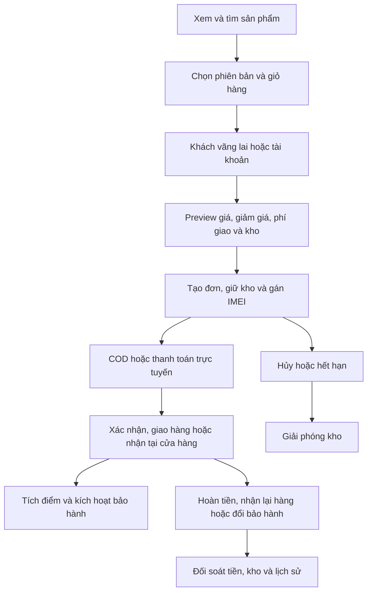

# kehoanh.md — Hướng dẫn AI sửa chữa dự án

## Yêu cầu thực thi cho AI

Bạn là AI lập trình viên làm việc trực tiếp trên dự án `D:\springboot`. Hãy thực hiện kế hoạch trong file này, sửa mã nguồn và kiểm chứng kết quả thực tế. Không dừng ở việc phân tích hoặc viết lại kế hoạch. Ưu tiên kế hoạch vận hành thật cập nhật 04/10/2026 bên dưới, bắt đầu OP-01 rồi tiền–đơn–kho. Các đợt cũ và checklist cũ giữ lại để đối chiếu lịch sử.

File này là nơi theo dõi tiến độ của đợt sửa chữa. Nội dung phía dưới gồm toàn bộ backlog, căn cứ source, phụ thuộc và tiêu chí nghiệm thu; các liên kết là tài liệu/bằng chứng hỗ trợ.

### Trình tự bắt đầu và tiếp tục công việc

1. Đọc hết file này và các `AGENTS.md` áp dụng. Kiểm tra nhánh, `git status --short`, các thay đổi hiện có và phiên bản runtime. Giữ nguyên thay đổi của người dùng; không reset để tạo working tree sạch.
2. Với câu hỏi về source, nếu có `graphify-out/graph.json`, chạy `graphify query` trước các lượt tìm kiếm/đọc source rộng; dùng `path`/`explain` khi cần. Nếu chưa có graph, áp dụng skill Graphify để xây graph. Đối chiếu source thực tế trước kết luận và chạy `graphify update .` sau sửa code.
3. Xem các kết quả bên dưới là baseline lịch sử của ngày 02/10/2026. Chạy lại kiểm tra cho source đang làm, lưu manifest và kết quả riêng; không lấy 59 tests cũ làm bằng chứng cho code mới.
4. Tái hiện ticket ưu tiên cao, ghi expected/actual và evidence. Nếu source đã được sửa ở lượt khác, kiểm chứng rồi cập nhật trạng thái thay vì sửa lại máy móc. Rà soát thêm lỗi liên quan; phát hiện mới bổ sung ID `R-15` trở đi, không đổi ID cũ.
5. Chọn một ticket hoặc nhóm phụ thuộc nhỏ, triển khai backend/migration/UI cần thiết, chạy test phù hợp, rồi cập nhật checklist và nhật ký ngay trong file này. Không làm đồng thời những thay đổi lớn khó xác định nguyên nhân lỗi.
6. Tiếp tục ticket kế tiếp sau khi kiểm tra đạt. Không xin xác nhận lại cho các bước đọc, sửa local và kiểm thử thông thường nằm trong kế hoạch. Nếu thiếu dữ liệu/provider/quyết định nghiệp vụ thực sự bắt buộc, ghi rõ phần phụ thuộc và tiếp tục các phần độc lập.
7. Khi gần hết phiên làm việc, lưu trạng thái đủ để AI khác tiếp tục: đang làm ticket nào, file đã sửa, test đã chạy, lỗi còn lại và bước tiếp theo chính xác. Không đánh dấu hoàn tất chỉ vì đã có code hoặc hết thời gian.

### Quy tắc quyết định và kiểm chứng

- Ưu tiên sửa tận gốc; không bỏ CSRF/ownership/version/transaction/lock để làm test hoặc UI chạy được. Không thay dữ liệu thật bằng mock để coi chức năng đã đạt.
- Phân biệt lỗi đã tái hiện, rủi ro từ source, thiếu chức năng và phụ thuộc triển khai. Nếu giả thuyết không tái hiện được, ghi kết quả và giữ phạm vi điều tra hợp lý; không bịa lỗ hổng.
- Nghiệp vụ đã có spec thì tuân theo spec. Với khoảng trống có thể giải quyết bằng lựa chọn an toàn và đảo ngược được, ghi giả định cụ thể rồi triển khai; không tự đặt chính sách hoàn tiền/thu tiền thật khi chưa có hợp đồng.
- Refund trước hết làm quy trình quản trị và ledger đối soát thủ công rõ trạng thái; chỉ báo refund thành công khi có bằng chứng thực tế. VNPay/SMS/email/OAuth chưa cấu hình thì hoàn thiện contract và tests bằng môi trường test, ghi riêng phần live chưa kiểm chứng.
- Test dùng H2 in-memory hoặc DB MySQL test riêng đã xác minh; không dùng DB nghiệp vụ để truncate/seed/restore. Tạo migration mới sau version cao nhất thực tế, có bản MySQL và H2, giữ migration đã áp dụng.
- Không in bí mật ra chat/log/tài liệu. Khi thiếu môi trường kiểm thử, ghi đúng kiểm tra chưa chạy và cách chạy lại. Không tự push/merge/deploy/gửi thông điệp bên ngoài từ yêu cầu sửa local.
- Trạng thái “Đã nghiệm thu” chỉ sau các acceptance criteria của ticket thực sự đạt. Tick checklist tương ứng và dẫn tới evidence của source cuối. Tính năng live thiếu provider vẫn còn mở dù tests local đạt.

### Cách bàn giao cuối mỗi đợt

Báo cáo ngắn bằng tiếng Việt: ticket đã sửa và hành vi mới; file chính; lệnh/test và kết quả thực; ticket còn mở/phụ thuộc; bước kế tiếp. Cập nhật file này trước khi kết thúc phiên. Khi sửa code, cập nhật các hợp đồng/tài liệu liên quan và Graphify.

<!-- PRODUCTION_PLAN_20261004_START -->
## Kế hoạch vận hành thật — cập nhật 04/10/2026

**Trạng thái: Đã chốt kế hoạch; chưa triển khai các ticket mới bên dưới.** Các nghiệm thu và checklist cũ là lịch sử, không đóng các phát hiện mới của đợt đánh giá này. AI tiếp tục từ OP-01; không lặp lại việc chỉ viết kế hoạch.

### 1. Kết luận và phạm vi kiểm tra

Dự án có nền tảng chức năng khá đầy đủ, nhưng chưa nên đưa vào vận hành thật. Những vấn đề ưu tiên nằm ở hoàn tiền, đối chiếu doanh thu, lịch sử bảo hành và giữ kho.

Đã rà Graphify, cấu trúc 121 file Java, 39 template, các luồng xử lý chính, cấu hình triển khai và bằng chứng kiểm thử hiện có. Kiểm tra mới trên bản demo H2 gồm:

- 140 lượt hiển thị: 35 tuyến trang × màn hình 320, 390, 768 và 1440px.
- Không phát hiện tràn ngang, ảnh hỏng hoặc lỗi JavaScript trong các trạng thái đã kiểm tra.
- Tái hiện các nhánh đăng nhập, giỏ hỗn hợp, giao hàng, hoàn tiền và đổi bảo hành.

Kết quả hiển thị: [audit-layout-matrix.json](target-h2/audit-layout-matrix.json). Đây là kiểm tra cục bộ; chưa xác minh SMTP, Google OAuth, VNPay và HTTPS trên môi trường thật. Lượt đánh giá không sửa source. Lượt bắt đầu triển khai sau đó mới đọc source và chưa áp dụng thay đổi trước khi được yêu cầu lưu kế hoạch.

### 2. Các luồng thông tin và workflow



Các điểm xử lý cần giữ:

- Checkout tính lại giá ở máy chủ, kiểm tra phiên bản giỏ và dùng khóa chống tạo đơn trùng.
- Đơn hàng lưu thông tin sản phẩm tại thời điểm mua; kho có sổ biến động và IMEI có lịch sử trạng thái.
- VNPay tách trang quay về khỏi IPN xác nhận thanh toán.
- Khách vãng lai có phạm vi truy cập riêng và cookie chứng minh quyền xem đơn.
- Reset mật khẩu dùng token một lần; liên kết Google không tự ghép tài khoản chỉ vì trùng email.

Điểm đứt luồng tập trung ở lúc chuyển tài khoản và các tình huống sau bán hàng, không chỉ ở giao diện mua hàng ban đầu.

### 3. Backlog mới và checklist triển khai

“Đã tái hiện” là hành vi chạy thực tế trên H2. “Từ source” là kết luận qua mã hoặc cấu hình. Không coi toàn bộ bảng là lỗ hổng bảo mật đã khai thác.

| ID | Ưu tiên | Vấn đề và bằng chứng | Trạng thái |
|---|---|---|---|
| OP-01 | P1 | Hoàn đủ tiền khi đang giao: đã tái hiện `SHIPPED/REFUNDED`, giao tiếp trả `409 PAYMENT_REQUIRED`, kho chưa hoàn. Căn cứ: `RefundService.java:223`. | Đã nghiệm thu |
| OP-02 | P1 | Báo cáo thiếu thu ròng sau hoàn và không thống nhất tiền hàng: hoàn đủ 15.990.000₫ vẫn thể hiện 15.990.000₫; dashboard dùng subtotal, báo cáo kênh trừ discount. Căn cứ: `ReportingService.java:24`. | Đã nghiệm thu |
| OP-03 | P1 | Đổi bảo hành làm phiếu sửa chữa cũ hiển thị serial máy mới. Đã tái hiện vì phiếu lấy serial từ thẻ đang cập nhật. Căn cứ: `WarrantyService.java:28`. | Đã nghiệm thu |
| OP-04 | P1 | COD giao nhà không có hạn tự hết: đã tái hiện `holdExpiresAt=null`; bộ hết hạn bỏ qua nhóm này. Căn cứ: `OrderService.java:114`. | Đã nghiệm thu |
| OP-05 | P1 trước triển khai | Compose không tự bật production, Secure cookie hoặc truyền đủ public URL/SMTP/Google; ProductionSafety chỉ chạy khi đúng profile. Căn cứ: `compose.yml:25`. | Đã nghiệm thu |
| OP-06 | P2 | Giỏ IMEI + phụ kiện được thêm nhưng chặn muộn tại checkout, thiếu hướng dẫn tách đơn. [Ảnh checkout](target-h2/audit-checkout-mobile.png). | Đã nghiệm thu |
| OP-07 | P2 | Đăng nhập từ giỏ về trang sản phẩm; giỏ guest có hàng nhưng giỏ tài khoản mới rỗng. Đã tái hiện. | Đã nghiệm thu |
| OP-08 | P2 | Giỏ guest có một sản phẩm nhưng header ghi 0; thêm nhanh ở danh sách sản phẩm đưa khách tới login. Đã tái hiện. | Đã nghiệm thu |
| OP-09 | P2 | Đơn đã hoàn đủ hiển thị “Chưa thanh toán”; khách thiếu giao diện yêu cầu hoàn tiền dù API đã có. Đã tái hiện. | Đã nghiệm thu |
| OP-10 | P2 | Session hết hạn không được giải thích; trang cấm trả JSON; enum tiếng Anh, giờ UTC và mã chi nhánh nội bộ. | Đã nghiệm thu |
| OP-11 | P2 | Trả góp quảng bá 0% dù có trường phí, quản trị vẫn duyệt demo; thiếu lịch trả/tổng phí trước xác nhận. | Đã nghiệm thu |
| OP-12 | P2 | Quản trị dùng ID biến thể/thẻ bảo hành; IMEI thiếu tìm kiếm/phân trang; nghiệp vụ tập trung trong một trang dài. | Đã nghiệm thu |
| OP-13 | P2 | Đánh giá tự APPROVED; limiter/session từng tiến trình; email chưa có retry bền vững qua restart. Từ source. | Đã nghiệm thu |

- [x] OP-01: hoàn tiền và thu hồi đơn đang giao.
- [x] OP-02: báo cáo, CSV và đối chiếu khoản hoàn.
- [x] OP-03: serial trên phiếu sửa chữa và lịch sử đổi máy.
- [x] OP-04: hạn xác nhận COD.
- [x] OP-05: cấu hình production.
- [x] OP-06: giỏ hỗn hợp tách nhóm có hướng dẫn.
- [x] OP-07: quay lại ngữ cảnh mua hàng và gộp giỏ guest.
- [x] OP-08: đồng bộ trải nghiệm guest.
- [x] OP-09: giao diện thanh toán/hoàn tiền.
- [x] OP-10: trạng thái, thời gian và trang lỗi.
- [x] OP-11: trả góp, phí và giới hạn demo.
- [x] OP-12: giao diện quản trị theo nghiệp vụ.
- [x] OP-13: kiểm duyệt đánh giá, email outbox và điều kiện nhiều instance.
- [ ] LIVE-01: SMTP và Google OAuth trên môi trường được cấp.
- [ ] LIVE-02: HTTPS, VNPay, CI và restart/backup/restore staging.

### 4. Thứ tự và cách sửa

#### Đợt 1 — Tiền, kho và lịch sử

- OP-01: với đơn đang giao, hoàn đủ phải qua xác nhận thu hồi hàng. Chưa nhận lại hàng thì chưa hoàn tất; sau đó hủy đơn và giải phóng kho đúng một lần. Giữ hoàn một phần và việc trả kho là các sự kiện tách biệt; khách không được tự xác nhận đã nhận lại hàng.
- OP-02: thống nhất dashboard, báo cáo kênh và CSV; tách tiền hàng, giảm giá, tiền hoàn và thu ròng. Giữ lịch sử bán; khoản hoàn được ghi nhận theo ngày hoàn tất.
- OP-03: lưu serial tại thời điểm tiếp nhận trên phiếu sửa chữa; sự kiện đổi máy chứa serial cũ/mới, người thao tác và thời gian. Không thay lịch sử cũ bằng serial mới. Dữ liệu cũ chưa khôi phục được serial phải ghi rõ giới hạn, không bịa lịch sử.
- OP-04: hạn xác nhận COD chưa xác nhận mặc định 24 giờ, cấu hình được. Đơn đã xác nhận cần xử lý chậm hoặc hủy bởi nhân viên; không tự hủy như đơn bỏ dở.

#### Đợt 2 — Workflow khách hàng và giao diện

- OP-06: theo lựa chọn đã chốt, tách đơn có hướng dẫn. Chia nhóm IMEI/phụ kiện ngay trong giỏ; hiển thị tổng và phí từng nhóm. Checkout nhóm nào chỉ xóa các dòng nhóm đó.
- OP-07: sau đăng nhập, quay lại tuyến mua hàng hợp lệ ban đầu, không cho redirect ra ngoài. Gộp giỏ guest vào tài khoản với kiểm tra số lượng/phiên bản/tồn kho; không tự đổi chủ các đơn guest đã đặt. Hàng không gộp được phải giữ lại và thông báo.
- OP-08: đồng bộ số lượng giỏ guest, hành vi thêm hàng và đường dẫn mua tiếp.
- OP-09: hiển thị riêng chưa trả/đang xử lý/thất bại/đã trả/đã hoàn. Bổ sung yêu cầu hoàn tiền và theo dõi kết quả cho khách, có scope ownership.
- OP-10: Việt hóa trạng thái, dùng giờ Việt Nam và tên chi nhánh; trang lỗi HTML và hướng dẫn session hết hạn. API vẫn giữ lỗi JSON đúng HTTP status.
- OP-12: ID quản trị chuyển thành tìm kiếm/chọn đối tượng; phân trang IMEI; tách màn hình kho, trả góp và bảo hành.

#### Đợt 3 — Điều kiện mở vận hành thật

- OP-05: cấu hình production rõ ràng; từ chối khởi động nếu bật demo/mock hoặc thiếu cấu hình an toàn bắt buộc. Cấu hình phát triển/demo phải tách biệt.
- OP-13: hàng đợi gửi email lưu trong DB, retry sau restart, có trạng thái và giới hạn retry; không log token hoặc bí mật. SMTP và Google OAuth tiếp tục theo lựa chọn trước đó.
- OP-11: ẩn trả góp demo khỏi môi trường thật tới khi có quy trình tài trợ xác minh; hiển thị phí và lịch trả trước khi đặt.
- OP-13: thêm hàng chờ kiểm duyệt đánh giá. Giữ một instance giai đoạn đầu; chỉ mở nhiều instance sau khi session và limiter dùng chung. Không coi việc giữ một instance là đã hoàn thành hỗ trợ nhiều instance.
- LIVE-01/LIVE-02: xác minh email thật, Google callback, HTTPS, VNPay, CI và phục hồi backup trên staging trước mở bán. Thiếu provider thì hoàn thành phần source/local độc lập, ghi rõ phần live còn mở.

Thay đổi giao diện/API cần có: nhóm giỏ, trạng thái hoàn trả hàng, khoản tiền báo cáo tách rõ và lịch sử serial bảo hành. Migration mới phải sau version cao nhất thực tế, có MySQL/H2, giữ dữ liệu lịch sử và không sửa migration đã áp dụng.

### 5. Nghiệm thu và lựa chọn đã chốt

- Hoàn tiền ở từng trạng thái; hoàn một phần/toàn phần; gửi lại và thao tác đồng thời. Tiền, kho, điểm, bảo hành thay đổi đúng số lần.
- Đơn bán và hoàn đủ trong cùng kỳ: báo cáo thể hiện khoản hoàn và thu ròng bằng 0; dashboard/báo cáo kênh/CSV khớp. Kiểm cả khoản hoàn khác kỳ và giảm giá.
- Tiếp nhận sửa chữa → đổi máy → xem phiếu cũ: serial ban đầu được giữ; có sự kiện đổi riêng.
- COD hết hạn trả kho một lần; không tự hủy đơn đã trả hoặc đã xác nhận.
- Giỏ hỗn hợp thanh toán lần lượt hai nhóm; đăng nhập giữa luồng không mất hàng hoặc tạo đơn trùng.
- Kiểm session hết hạn, mất mạng, gửi lại checkout, quyền xem đơn người khác và các trạng thái lỗi desktop/mobile.
- Chạy lại H2/MySQL sau sửa; kiểm email thật, Google callback, VNPay, restart/restore trên staging. Kết quả local không thay thế nghiệm thu live.

**Đã chốt:** vận hành thật; giỏ hỗn hợp tách đơn có hướng dẫn; SMTP và Google OAuth; SMS để sau; giữ thay đổi hiện có. Sửa code xong phải cập nhật Graphify và tài liệu hợp đồng liên quan.

Mỗi ticket chỉ tick khi đạt tiêu chí; bổ sung nhật ký dưới đây với file chính, lệnh test, số test PASS/FAIL, evidence và source manifest. Bước bắt đầu kế tiếp: tái hiện OP-01 trên test riêng, thêm test hồi quy, triển khai thu hồi hàng/hoàn tiền rồi kiểm cả retry và concurrency.

| Ngày | Ticket | Thay đổi | Kiểm thử / bằng chứng | Trạng thái |
|---|---|---|---|---|
| 04/10/2026 | Kế hoạch OP-01–OP-13 | Lưu kế hoạch đã chốt; bảo toàn backlog và nhật ký cũ | Kiểm tra file Markdown và các mục cần triển khai; chưa sửa source, chưa chạy nghiệm thu code mới | Đã lưu kế hoạch |
| 04/10/2026 | OP-01 | Mở rộng RefundService: đơn SHIPPED hoàn đủ bắt buộc xác nhận thu hồi hàng (`restockItems=true`), tự chuyển CANCELLED/REFUNDED, giải phóng kho và nhả serial đúng 1 lần; hoàn một phần giữ nguyên trạng thái SHIPPED | `RefundAndReconciliationTest` (8 tests PASS) | Đã nghiệm thu OP-01 |
| 04/10/2026 | OP-02 | Thống nhất doanh thu: ReportingService, CommerceReportingService và ReportExportService tách rõ subtotal, discount, subtotal sau giảm, tiền hoàn đã SUCCEEDED theo kỳ hoàn, và thu ròng | `CommerceReportingComprehensiveTest` (2 tests PASS), CSV & dashboard hiển thị khớp | Đã nghiệm thu OP-02 |
| 04/10/2026 | OP-03 | Migration V23 bổ sung `imei_number` vào `repair_tickets` và bảng `warranty_exchanges`; tiếp nhận sửa lưu snapshot serial; đổi máy lưu sự kiện lịch sử và bảo toàn serial cũ trên phiếu sửa chữa cũ | `WarrantyMigrationTest` (1 test PASS), `WarrantyExchangeAndHistoryTest` (1 test PASS) | Đã nghiệm thu OP-03 |
| 04/10/2026 | OP-04 | Đơn COD giao tiêu chuẩn tự động thiết lập hạn xác nhận `holdExpiresAt` (mặc định 24h cấu hình qua `app.order.cod-expiry-hours`); chuyển CONFIRMED xóa hạn giữ; PickupService.expire tự hủy đơn COD PENDING quá hạn và giải phóng kho | `OrderHoldExpiryAndRejectionTest` (5 tests PASS) | Đã nghiệm thu OP-04 |
| 04/10/2026 | OP-05 | compose.yml mặc định bật profile `production`, `SESSION_COOKIE_SECURE=true`, cấm mock/demo/bootstrap admin ngầm định; bảo vệ ProductionSafety hoạt động chuẩn xác | `ProductionSafetyTest` (3 tests PASS) | Đã nghiệm thu OP-05 |
| 04/10/2026 | OP-06 | Phân nhóm giỏ hàng thông minh (thiết bị quản lý IMEI vs phụ kiện thông thường), hướng dẫn thanh toán từng nhóm, hiển thị tổng tiền riêng từng nhóm, checkout dòng đã chọn | `cart.html`, `app.js`, `checkout.html` | Đã nghiệm thu OP-06 |
| 04/10/2026 | OP-07 | Bảo toàn ngữ cảnh redirect sau đăng nhập (chống open redirect); gộp giỏ hàng guest vào tài khoản với kiểm tra tồn kho, version giỏ | `CartService.mergeGuestCart`, `SecurityConfig`, `GuestCartMergeAndExperienceTest` (2 tests PASS) | Đã nghiệm thu OP-07 |
| 04/10/2026 | OP-08 | Đồng bộ badge số lượng giỏ guest trên header; cho phép guest thêm nhanh sản phẩm vào giỏ không bắt login; hiển thị đầy đủ giỏ guest | `StorefrontModel`, `techzone.js`, `GuestCartMergeAndExperienceTest` | Đã nghiệm thu OP-08 |
| 04/10/2026 | OP-09 | Đồng bộ trạng thái thanh toán và hoàn tiền: hiển thị PAID kèm refundedAmount khi hoàn 1 phần, chuyển REFUNDED khi hoàn đủ; API gửi yêu cầu hoàn tiền cho customer và guest lookup; form hoàn tiền giao diện khách hàng | `OrderStatusAndRefundUxTest` (1 test PASS), `RefundAndReconciliationTest` (8 tests PASS) | Đã nghiệm thu OP-09 |
| 04/10/2026 | OP-10 | Trang lỗi HTML chuẩn phong cách TechZone, thông báo tiếng Việt giải thích session hết hạn, lỗi kết nối, quyền truy cập; giữ API JSON chuẩn HTTP status code | `error-page.html`, `app.js`, `ErrorHandlingTest` (3 tests PASS) | Đã nghiệm thu OP-10 |
| 04/10/2026 | OP-11 | Minh bạch gói trả góp: loại bỏ quảng bá 0% gây hiểu lầm, tính toán phí và lịch thanh toán từng kỳ chi tiết; bảo vệ production: lọc bỏ plan demo khi ở profile production, từ chối duyệt demo trên production | `InstallmentTransparencyAndSafetyTest` (2 tests PASS), `checkout.html`, `app.js`, `InstallmentService.java`, `ProductionSafety.java` | Đã nghiệm thu OP-11 |
| 04/10/2026 | OP-12 | Nâng cấp quản trị: thẻ bảo hành hiển thị kèm tên máy và serial tiếp nhận; phiếu sửa chữa hiển thị đúng serial tiếp nhận ban đầu; form đổi máy trực quan; danh sách hoàn tiền hiển thị tiền VND và nút duyệt/từ chối nhanh | `admin/commerce.html`, `admin/refunds.html`, `WarrantyExchangeAndHistoryTest` | Đã nghiệm thu OP-12 |
| 04/10/2026 | OP-13 | Hàng đợi Outbox Email (Migration V24 `email_outbox`) gửi email bền vững qua restart với retry backoff và không log bí mật; kiểm duyệt đánh giá sản phẩm (trạng thái PENDING ban đầu, chỉ hiển thị storefront khi Admin duyệt) | `EmailOutboxAndReviewModerationTest` (2 tests PASS), `ProductReviewServiceTest` (6 tests PASS), `EmailOutboxService.java`, `ReviewApi.java`, `ProductReviewService.java` | Đã nghiệm thu OP-13 |
<!-- PRODUCTION_PLAN_20261004_END -->

## Tiến độ lịch sử trước đợt vận hành thật

Baseline lịch sử trước đợt mới: **Đã nghiệm thu source và luồng local; còn phụ thuộc staging/provider (04/10/2026)**. Không dùng baseline này để đóng OP-01–OP-13. Hai lượt verify H2/MySQL đều PASS 124 tests sau R-19. Các số 59/82/116/121/122 trong nhật ký là lịch sử; chưa coi toàn bộ kế hoạch hoàn tất khi còn phần live/production bên dưới.

### Checklist sửa chữa

- [x] R-01 — CSV formula injection
- [x] R-02 — Tra cứu đơn công khai và bảo vệ thông tin khách
- [x] R-03 — Giới hạn thử đăng nhập
- [x] R-04 — Tách thu COD khỏi giao đơn online/trả góp
- [x] R-05 — Timeout/rejection và giải phóng giữ kho
- [x] R-06 — Refund/reconciliation có ledger
- [x] R-07 — Kiểm chứng cạnh tranh và invariant trên MySQL
- [x] R-08 — Lookup chính xác mã giao dịch
- [x] R-09 — Missing resource/validation trả đúng 4xx
- [x] R-10 — Phân trang giữ bộ lọc đơn
- [x] R-11 — Decode ảnh và giới hạn upload
- [ ] R-12 — Cấu hình production/session/mock/proxy
- [ ] R-13 — Logging chẩn đoán và CI/security scan
- [x] R-14 — Đo và tối ưu truy vấn catalog/routing
- [x] R-15 — Callback/reconciliation lặp và lock refund
- [x] R-16 — Hoàn kho có điều kiện và audit đảo điểm
- [x] R-17 — Entity coupon/payment đọc trước khóa gây version cũ khi cạnh tranh
- [x] R-18 — CSV điện thoại mất số 0 đầu khi Excel tự nhận dạng kiểu
- [x] R-19 — Hoàn tiền xóa bảo hành và cascade mất lịch sử sửa chữa

### Checklist chức năng

- [x] F-01 — Hồ sơ cá nhân và đổi mật khẩu
- [x] F-02 — Lọc hãng/dung lượng/giá/tồn theo variant
- [x] F-03 — Detail/gallery/cart/checkout
- [x] F-04 — Địa chỉ và quản lý đơn cá nhân
- [x] F-05 — Checkout các dòng đã chọn và xóa nhiều
- [ ] F-06 — Wishlist/so sánh/cửa hàng/quản trị nội dung
- [x] F-07 — Guest checkout an toàn trong phạm vi COD/giao tiêu chuẩn
- [ ] F-08 — Reset/OTP/social/avatar/voucher
- [ ] F-09 — News/CMS/newsletter

### Tiếp tục ngày 03/10/2026

- Đã đọc toàn bộ kế hoạch và tham khảo Graphify trước source; giữ working tree hiện có. Build riêng `target-repair` vì bản demo đang giữ khóa JAR trong `target`.
- R-10: sửa hàm validation không tồn tại, kiểm fromDate/toDate và regression cho link trước/sau giữ mọi filter.
- R-11: decode ảnh thực, kiểm dimensions/pixels trước cấp phát, decoder WebP, multipart 5MB/6MB. Ảnh PNG fixture cũ hỏng đã thay bằng PNG tạo hợp lệ.
- R-12: production guard Secure cookie/demo/mock/bootstrap/trusted proxy; lưu IP khách vào giao dịch V12. Chưa có staging HTTPS thật.
- R-13: log requestId + class/cause/stack locations, bỏ message có thể chứa SQL/PII. Scanner đang triage; CI/browser còn cần hoàn thiện.
- R-14: cùng 12 cards/20 samples, baseline 101 queries/p95 306ms; sau batch 9 queries/p95 41ms. Đây là phép đo local H2, chưa suy ra tốc độ production. Routing đã đổi thành đọc matrix kho một lần, còn kiểm tra hồi quy.
- F-01/04/05: hồ sơ + đổi mật khẩu/expire mọi session; địa chỉ owner-only/default/version; checkout subset/hash/idempotency giữ dòng không chọn, xóa nhiều và mua lại. Tám ca profile/address/refund đã PASS; subset test đã PASS ở lượt targeted sau sửa null check.
- F-02: hãng lấy từ dữ liệu có cấu trúc (không đoán tên); giá/dung lượng/tồn phải thuộc cùng variant; facet counts là giao của các filter đang áp dụng. Kiểm thử filter đã PASS trong 34 ca commerce/auth/refund.
- F-06/08/09: wishlist, avatar, news CMS văn bản escaped, newsletter double opt-in, reset password token 15 phút/hash-only; Google email collision cần xác nhận mật khẩu để liên kết. Các suite content/auth targeted 6 tests PASS, SMTP dùng hộp thư test nội bộ, Google kiểm claims test; không tuyên bố gửi mail/đăng nhập Google thật.
- Người dùng chọn SMTP + Google OAuth, SMS để sau. Chờ cấu hình `SMTP_*`, `GOOGLE_CLIENT_*`, `APP_PUBLIC_URL`; không ghi khóa vào tài liệu.
- F-07: đang hoàn thiện guest cart + COD/giao tiêu chuẩn, session riêng và proof cookie HttpOnly 30 ngày. Không mở API customer. Lỗi biên dịch DTO userId đã sửa bằng query có scope; cần test guest rồi browser.
- Phát hiện mới R-15: callback thành công lặp ghi thêm history, callback thất bại đến muộn tạo đối soát sai, refund REQUIRES_NEW tự chờ khóa order; đã sửa success guard/shared transaction/order-first lock và thêm regression.
- Phát hiện mới R-16: hoàn hàng một phần có thể trả lại toàn bộ kho; customer không được xác nhận nhận hàng. Giới hạn manual full return cho admin; hủy chưa giao cần hoàn đủ. Ledger điểm không xóa award: V16 lưu reversal độc lập/idempotent.
- Browser 11 luồng/85 lượt trang ở 320/390/768/1024/1440px đã PASS trên demo riêng, không lỗi JS/tràn ngang. Đã quét source/history Git: 0 findings redacted; nâng Jackson 3.1.7/Tomcat 11.0.25, OSV runtime 120 packages: 0 findings.
- Hai lượt verify H2/MySQL đã PASS 116 tests trước phát hiện R-17. Năm ca race mới bổ sung; bốn race + 12 unit tests coupon/payment sau sửa đã PASS 16 tests trên mỗi DB. Không dùng 116 tests trước R-17 làm bằng chứng cuối cho service vừa sửa.
- R-17 tái hiện trên MySQL: preview coupon và lookup transaction đưa entity version cũ vào persistence context trước khóa; cạnh tranh sinh ObjectOptimisticLockingFailureException. Sửa preview dùng CouponQuote DTO, lookup payment/IPN dùng scalar orderId rồi khóa order → transaction. Giữ amount/signature/ownership/idempotency.
- Sau R-18, full verify đã PASS 122 tests trên mỗi lượt H2/MySQL ngày 03/10. Excel thật mở CSV, lưu XLSX và mở lại: 12 giá trị không có formula, Unicode/quote/newline đúng, điện thoại giữ số 0 đầu bằng apostrophe text guard. Guard này có thể hiển thị trong Excel; không dùng công thức để giữ số điện thoại. Evidence: `qa/repair-continuation/csv-excel.json`, script `scripts/verify-csv-excel.ps1`.
- Tiếp tục 04/10: tái hiện R-19 bằng regression trên hành vi cũ: sau refund thẻ bảo hành còn 0 thay vì 1, lịch sử repair bị cascade xóa. Đổi sang `revoked_at`, giữ repair/card; tra cứu/nhận bảo hành/đổi máy chỉ dùng thẻ chưa thu hồi. V22 Java migration cho MySQL/H2 thay unique serial toàn cục bằng unique active serial + order/serial; máy bán lại có thẻ mới, lịch sử cũ giữ liên kết cũ. Full verify cuối PASS 124 tests trên mỗi lượt; upgrade V21 có dữ liệu cũ PASS cả H2 và MySQL, migration chạy lại không thay dữ liệu.
- Browser cuối dùng JAR `target-repair` trên MySQL test riêng: 11 luồng/85 lượt trang PASS tại 320/390/768/1024/1440px; có fault injection 409 ghi rõ, các thao tác còn lại chạy thực. Upload WebP GET trước/sau restart ứng dụng riêng có cùng SHA-256. Evidence: `qa/repair-continuation/browser/result.json`, `upload-restart.json`, `migration-upgrade-mysql.json`.
- Scanner source cuối: Gitleaks không phát hiện secrets; Git history trước đó cũng 0 findings. OSV kiểm tra 120 runtime packages đã resolve: 0 advisory findings sau nâng Jackson/Tomcat. Đây là kết quả trong phạm vi scanner, không phải cam kết không còn mọi lỗ hổng.
- Backup/restore local có dữ liệu từ browser đã PASS: 38 bảng, 3 ảnh upload; đối chiếu row count và normalized schema/data/file SHA-256. Script xác minh marker + datadir, chỉ tạo schema test đích mới, không overwrite. Evidence `qa/repair-continuation/restore.json`; đây không phải backup/restore production.

### Nhật ký triển khai

| Ngày/phiên | Ticket | Hành vi tái hiện / thay đổi | Kiểm tra và evidence | Trạng thái / bước tiếp theo |
| --- | --- | --- | --- | --- |
| 02/10/2026 — tạo kế hoạch | Baseline | Rà soát ban đầu; chưa sửa application source | Verify H2: 59 tests, 0 failures/errors | Mở baseline |
| 02/10/2026 | R-01 | Escape CSV chống formula injection (`=`, `+`, `-`, `@`, `\t`, `\r`), prefix `'` và quote RFC 4180 an toàn cho Excel/Calc | `ReportExportServiceTest` PASS (1 test) | Đã nghiệm thu R-01 |
| 02/10/2026 | R-02 | DTO công khai `PublicOrderView` che tên/phone/địa chỉ, bỏ note/pickupCode/paymentUrl; rate limit IP (15) và identifier (5) trả 429; thông báo lỗi đồng nhất | `OrderLookupTest` PASS (5 tests), `CommerceComprehensiveTest` PASS (4 tests) | Đã nghiệm thu R-02 |
| 02/10/2026 | R-03 | Tách giới hạn IP (20) và Account (5) độc lập chống spray và brute force phân tán; cơ chế eviction tránh unmetered bypass khi đầy cache; phục hồi sau 15 phút | `LoginAttemptsTest` PASS (5 tests) | Đã nghiệm thu R-03 |
| 02/10/2026 | R-04 | Tách thu COD khỏi đơn online PAID và trả góp; pickup tự điều chỉnh; form admin chỉ hiện checkbox COD khi là COD chưa trả; migration V10 cập nhật constraint `ck_orders_cod_v10` | `OmnichannelIntegrationTest` PASS (25 tests), `mvnw test` tổng cộng 71 tests PASS | Đã nghiệm thu R-04 |
| 02/10/2026 | R-08 | Lookup chính xác theo `transaction_code`, bỏ fallback ngầm từ mã TXN không tồn tại sang giao dịch mới nhất; tách hàm riêng `findLatestByOrderId` | `PaymentServiceTest` PASS (6 tests) | Đã nghiệm thu R-08 |
| 02/10/2026 | R-05 | Đơn online chưa thanh toán có hold deadline (15p) và đơn trả góp (48h); mở rộng cron quét đơn PENDING/CONFIRMED quá hạn để hủy và giải phóng tồn kho + serial IMEI; hồ sơ trả góp REJECTED tự động hủy đơn và nhả serial; từ chối callback thanh toán đến muộn trên đơn đã hủy | `OrderHoldExpiryAndRejectionTest` PASS (3 tests), full suite 75 tests PASS | Đã nghiệm thu R-05 |
| 02/10/2026 | R-06 | Migration V11 tạo bảng ledger `refund_reconciliations`; triển khai `RefundService` quản trị yêu cầu và thực thi hoàn tiền với mã chứng từ đối soát (`reference_code`); idempotency chống hoàn tiền 2 lần; trả kho và thu hồi điểm/bảo hành khi trả hàng thực tế; ghi nhận đối soát tự động khi thanh toán muộn trên đơn đã hủy | `RefundAndReconciliationTest` PASS (4 tests), full suite 79 tests PASS | Đã nghiệm thu R-06 |
| 02/10/2026 | R-09 | Xử lý `EmptyResultDataAccessException` trả 404 `RESOURCE_NOT_FOUND`; `ConstraintViolationException` và `MissingServletRequestParameterException` trả 400 `VALIDATION_ERROR`; `WarrantyService.transition` kiểm tra ID không tồn tại ném `BusinessException.missing()` thay vì để JDBC throw 500; nâng cấp logging chẩn đoán chi tiết trong `Errors.unexpected` | `ErrorHandlingTest` PASS (3 tests), full suite 82 tests PASS | Đã nghiệm thu R-09 |

### Điểm tiếp tục

- Phần source/local đã nghiệm thu theo evidence trong `qa/repair-continuation/README.md`; hợp đồng tại `docs/18-repair-continuation.md`. Full verify gồm cả unit tests và integration tests; một số suite catalog/upgrade chủ ý dùng H2 ở cả hai lượt, không phải mọi test đều truy cập MySQL.
- R-12 còn kiểm chứng HTTPS/cookie/proxy trên staging thật. R-13 đã có diagnostic logs, scan/triage và CI jobs local; cần một lần GitHub Actions chạy trên commit thực trước nghiệm thu pipeline từ xa.
- F-06 còn giờ/ảnh/toạ độ cửa hàng thật; wishlist, so sánh, metadata và CMS local đã có. F-08/F-09 còn SMTP delivery và Google Console/callback thực. SMS hoãn theo yêu cầu; newsletter chưa phát chiến dịch hàng loạt. Không đưa credentials vào chat/repository.
- Việc vận hành tiếp theo: cấu hình staging/SMTP/Google bên ngoài source, kiểm tra reset một lần/thu hồi session và newsletter double opt-in bằng hộp thư test thật; kiểm callback Google đã verified-email/collision; chạy HTTPS/VNPay/hoàn tiền provider theo môi trường được cấp. Guest cleanup/email recovery và shared limiter trước multi-instance vẫn còn mở; guest hiện chỉ COD giao tiêu chuẩn.

---

# Kế hoạch sửa lỗi, bảo mật và hoàn thiện TechShop / TechZone

Ngày lập: **02/10/2026**, giờ Việt Nam. Phạm vi: mã nguồn hiện tại tại `D:\springboot`.

**Thứ tự thực hiện: xác nhận lỗi → bảo mật → tiền/đơn/kho → chức năng chính → giao diện và chức năng mở rộng → nghiệm thu.** Đây là kế hoạch sửa chữa dựa trên rà soát ban đầu; các mục dưới đây chưa được sửa trong lượt lập kế hoạch.

## 1. Căn cứ và giới hạn

- Đã truy vấn Graphify trước khi rà soát source; graph hiện có 2.369 nodes, 5.328 edges. Dùng graph để tìm module; đối chiếu mã nguồn hiện tại để kết luận, vì CLI cảnh báo graph dùng hệ ID cũ.
- Stack kiểm tra từ `pom.xml`: Java 21, Spring Boot 4.1.1, Thymeleaf, Spring Security, JPA, Flyway; MySQL cho ứng dụng mặc định, H2 cho demo/test.
- HEAD khi kiểm tra: `6e66ee1646202953c39145ee420e9f90e804e411`, nhánh `feature/techshop-first-implementation`. Có nhiều thay đổi chưa commit, gồm 41 tệp tracked thay đổi và nhiều tệp/module mới. HEAD không đại diện đầy đủ cho working tree.
- Đã đọc đường đi auth, catalog, cart, checkout, payment, pickup, inventory, trade-in, installment, loyalty, warranty, export và tài liệu chức năng. Chưa kiểm thử khai thác toàn diện, chưa nghiệm thu production và chưa chạy lại toàn bộ browser E2E trong lượt này.
- Không đọc/in nội dung `.env`. Chưa quét dependency/secret toàn bộ lịch sử Git; không kết luận đã có CVE hay secret bị lộ khi chưa có bằng chứng.
- Kết quả kiểm thử baseline và dấu vết source được lưu riêng tại [bằng chứng](qa/repair-plan-20261002/baseline.json). Chỉ dùng kết quả của lần chạy này cho source tương ứng, không lấy báo cáo cũ làm bằng chứng hiện tại.

Các nhãn bằng chứng:

| Nhãn | Ý nghĩa |
| --- | --- |
| Xác nhận từ mã | Đã thấy hành vi/thiếu kiểm soát trong source, chưa có nghĩa đã khai thác thành công ở môi trường thật |
| Cần tái hiện | Có đường đi đáng nghi hoặc thiếu chính sách; cần test để chốt tác động |
| Thiếu chức năng | Chưa có hợp đồng/backend/UI đầy đủ, khác với chức năng đã tồn tại nhưng bị lỗi |
| Phụ thuộc triển khai | Mức rủi ro phụ thuộc môi trường/config thực tế |

P0 chỉ dùng khi xác nhận chiếm quyền quản trị, ghi nhận tiền giả, truy cập trái phép nghiêm trọng hoặc hỏng dữ liệu diện rộng. **Rà soát này chưa xác nhận lỗi P0.** P1 là ưu tiên xử lý trước mở rộng tính năng; P2 xử lý sau các invariant tiền/đơn/kho; P3 là mở rộng theo roadmap.

## 2. Backlog sửa chữa có căn cứ

| ID | Ưu tiên | Bằng chứng / vấn đề | Phạm vi và đầu ra sửa chữa | Nghiệm thu |
| --- | --- | --- | --- | --- |
| R-01 | P1 | Xác nhận từ mã: CSV chỉ escape dấu phẩy/quote/newline, không xử lý formula; tên/địa chỉ khách được phép bắt đầu bằng ký tự công thức | `ReportExportService.java` và hợp đồng export: xuất trường người dùng dưới dạng text an toàn, giữ dấu tiếng Việt, số điện thoại và cấu trúc cột | Payload lành tính `=1+1`, `+1+1`, `@SUM(1,1)`, tab/CR/quote/delimiter không được thực thi như formula khi mở bằng công cụ đích; kiểm tra cả lưu/mở lại nếu tiếp tục dùng CSV |
| R-02 | P1 | Xác nhận từ mã: tra cứu đơn công khai nhận ID tuần tự + số điện thoại; hiển thị tên, số, địa chỉ, ghi chú; chưa có limiter riêng | `LookupOrderController`, `OrderService.lookup`, `order-lookup.html`: giới hạn theo IP và định danh, DTO công khai tối thiểu, che dữ liệu; xem đầy đủ chỉ bằng owner session hoặc proof/token một lần | Đổi mã/phone không trả thông tin người khác; vượt ngưỡng nhận 429; kết quả công khai không chứa full address/note/pickup token/payment URL; không suy ra đơn tồn tại từ lỗi khác nhau |
| R-03 | P1 | Xác nhận từ mã: throttle login theo cặp IP+username; khi map đạt 10.000 entries thì không lưu key mới; state chỉ nằm trong một process | `LoginAttempts`, `SecurityConfig`: hạn mức account và IP độc lập, chống spray và giới hạn tài nguyên; lưu limiter chung khi chạy nhiều instance | Dùng nhiều IP cho cùng account và nhiều account cho cùng IP vẫn chạm giới hạn; đầy cache không mở đường đăng nhập không giới hạn; không khóa account vĩnh viễn; phục hồi sau expiry |
| R-04 | P1 | Xác nhận từ mã: giao mọi đơn đều bắt `codCollected=true`, kể cả online đã PAID/trả góp; pickup tự truyền true | `OrderService.transition`, `PickupService.collect`, `order.html`: tách xác nhận giao hàng, thu COD và xác nhận tài trợ; giữ state machine/order version | COD chưa thu không hoàn tất; online PAID hoàn tất mà không đánh dấu thu COD; installment được duyệt theo hợp đồng riêng; gửi lại không ghi thêm tiền/điểm/bảo hành |
| R-05 | P1 | Cần tái hiện/chốt chính sách: expiry chỉ áp dụng pickup; đơn online giao nhà thất bại/bỏ thanh toán và hồ sơ trả góp REJECTED có thể tiếp tục giữ kho | `PaymentService`, `InstallmentService.decision`, `PickupService`, `OrderService.cancel`: timeout/rejection/retry và giải phóng reservation có kiểm soát | Test hết hạn, từ chối, callback đến muộn và cancel cùng lúc; hoàn global stock/branch reservation/IMEI đúng một lần; giao dịch thật đã nhận tiền đi đối soát, không tự hủy như đơn chưa trả |
| R-06 | P1 | Thiếu quy trình nghiệp vụ: PAID bị chặn hủy với `REFUND_REQUIRED`; chưa có luồng xử lý hoàn tiền đầy đủ | Mô hình refund/reconciliation và màn hình admin; trước hết có ledger xử lý thủ công được kiểm toán, tích hợp gateway sau khi có cấu hình và xác minh hợp đồng | Có requested/processing/succeeded/failed và actor/reason/reference; retry không hoàn hai lần; chỉ trả kho/thu hồi điểm/bảo hành theo trạng thái hoàn trả hàng thực tế |
| R-07 | P1 kiểm chứng | Cần tái hiện: các luồng nhiều bảng và cạnh tranh phải được kiểm lại trên MySQL hiện tại | Bộ kiểm thử auth/ownership, checkout last-unit, coupon, IMEI, payment-vs-cancel, pickup-vs-expiry, trade-in và loyalty | Invariant đúng sau commit/rollback trên H2 và MySQL DB test riêng; không bán một serial hai lần, âm tồn, duplicate order, duplicate refund/points; lỗi tranh chấp có response rõ |
| R-08 | P2 | Xác nhận từ mã: `findByCode` fallback từ mã TXN không tồn tại sang giao dịch mới nhất của order | `PaymentService.findByCode`, mock/return/resume callers: lookup chính xác theo transaction code, tách rõ lookup theo order nếu có nhu cầu | Sai suffix hoặc mã giao dịch cũ không ánh xạ âm thầm sang giao dịch khác. IPN đang lookup exact và verify chữ ký/amount: phải giữ bảo vệ này; chưa xác nhận bypass IPN |
| R-09 | P2 | Xác nhận từ mã: `WarrantyService.transition` dùng `queryForObject` cho ID có thể không tồn tại; error handler không có mapping missing-row tương ứng | Các service JDBC + `Errors`: missing resource trả 404, input sai 400, stale/state conflict 409; ràng buộc DTO lồng nhau | Repair ID không tồn tại và các path tương tự không trở thành 500; giữ error code/requestId; không lộ SQL/stacktrace |
| R-10 | P2 | Xác nhận từ mã: phân trang `orders.html` chỉ giữ page/status, bỏ keyword/fromDate/toDate | Template đơn + query/controller; thêm kiểm tra fromDate ≤ toDate | Lọc đơn admin → trang sau/trước vẫn giữ cùng bộ lọc và kết quả; reset xóa đầy đủ; owner scope không thay đổi |
| R-11 | P2 | Xác nhận từ mã: upload kiểm MIME, kích thước, vài byte signature nhưng không decode nội dung ảnh | `FileStorageService`: kiểm ảnh thực, giới hạn dimensions/pixels, đồng bộ multipart cap; encoder hỗ trợ WEBP hoặc policy định dạng rõ; kiểm quyền và lưu trữ | File chỉ có header ảnh nhưng hỏng bị từ chối; ảnh lớn quá ngưỡng không gây cạn memory; upload hợp lệ và restart còn ảnh; giữ UUID filename/path traversal guard/rollback đang có |
| R-12 | P2 | Phụ thuộc triển khai: cookie secure mặc định false, demo bật mock; payment URL/client IP đang dùng localhost/127.0.0.1 ở các call site | Production profile/config validation, HTTPS, trusted proxy/client IP, tắt demo/mock, kiểm bootstrap-admin và logging secret | Production không khởi động với tổ hợp config nguy hiểm theo policy; cookie qua HTTPS có Secure; mock không dùng được; không tin mọi X-Forwarded-For; lỗi chỉ chứa mã kiểm tra |
| R-13 | P2 | Xác nhận từ mã: handler lỗi bất ngờ chỉ log class, khó truy ra nguyên nhân; CI hiện chạy H2/MySQL tests nhưng chưa có bước scan dependency/secret/browser riêng | Structured log có requestId + diagnostic cause phù hợp, che PII/token; thêm scan có báo cáo, CI lưu evidence và browser job | Có thể truy lỗi bằng requestId; log không chứa password/token/địa chỉ đầy đủ; findings scanner được triage chứ không coi mọi cảnh báo là exploit |
| R-14 | P2 | Xác nhận cấu trúc truy vấn: trang catalog lấy ảnh/rating/variants/tồn cho từng sản phẩm và biến thể | Batch query/projection cho listing và route candidates sau khi nghiệp vụ đã ổn | Đo query count và p95 trước/sau với bộ dữ liệu cố định; kết quả/giá/tồn không thay đổi; không đặt mục tiêu tốc độ tùy ý khi chưa đo baseline |
| R-15 | P1 | Callback trùng/đến muộn và refund transaction có thể ghi history/đối soát sai hoặc tự chờ khóa | Success guard, reconciliation cùng transaction, khóa order trước transaction/refund | Callback lặp không tạo thêm ledger/history; thanh toán muộn không khôi phục đơn đã hủy; refund retry không thực hiện hai lần |
| R-16 | P1 | Refund một phần có thể hoàn toàn bộ kho; xóa award làm mất audit điểm | Chỉ admin full return được restock; reversal điểm riêng V16 | Giữ award, đảo điểm một lần; hoàn kho đúng trường hợp; customer không tự xác nhận nhận hàng |
| R-17 | P1 | Entity coupon/payment được đọc trước khóa, MySQL race dùng version cũ | CouponQuote DTO và scalar payment orderId trước thứ tự khóa order → transaction | Last-use coupon một winner; callback/cancel/pickup/expiry/IPN cạnh tranh không 500/duplicate award/kho/đơn |
| R-18 | P2 | Excel tự parse số phone làm mất số 0 đầu | Export phone dưới dạng guarded text; không dùng formula | Mở CSV, lưu XLSX, mở lại: giữ số 0 đầu, Unicode/escaping đúng, không HasFormula |
| R-19 | P1 dữ liệu | Refund xóa warranty_cards, FK cascade xóa repair_tickets | Soft revoke; V22 unique active serial/order-serial; khóa order → card khi đổi máy | Lịch sử cũ còn nguyên; thẻ thu hồi không dùng được; bán lại tạo thẻ mới; upgrade V21 có dữ liệu cũ và repeat migration PASS |

### Căn cứ source để người sửa kiểm tra nhanh

- R-01: `src/main/java/vn/techshop/reporting/ReportExportService.java`, `escapeCsv` và các trường recipient/address; `shared/Rules.java`, `text` chỉ kiểm độ dài.
- R-02: `order/OrderService.java:144–154,186`; `config/SecurityConfig.java:36`; `templates/order-lookup.html:65–72`. DTO nội bộ chứa pickupCode/paymentUrl nhưng template hiện tại **không** hiển thị hai trường đó; yêu cầu DTO riêng là phòng tránh mở rộng làm lộ chúng.
- R-03: `config/LoginAttempts.java:14–20`; `config/SecurityConfig.java:20–25,39–40`.
- R-04: `order/OrderService.java:164–175`; `order/PickupService.java:22–24`; `templates/order.html:3`. Đây là lỗi ngữ nghĩa/state, chưa có bằng chứng gateway bị trừ tiền hai lần.
- R-05: `order/PickupService.java:26–35`; `installment/InstallmentService.java:27–31`; `order/OrderService.java:103–113,156–162`.
- R-06: `order/OrderService.java:159`; `payment/PaymentService.java:108,184`.
- R-08: `payment/PaymentService.java:140–152`; IPN dùng exact code ở dòng 176.
- R-09: `warranty/WarrantyService.java:33–36`; `shared/Errors.java`, handler Exception.
- R-10: `templates/orders.html:1`, pagination; `config/WebController.java`, adminOrders; `order/OrderService.java:120–140`.
- R-11: `shared/FileStorageService.java:35–62`.
- R-12: `resources/application.yml:24–27,34–43`; `resources/application-demo.yml:11`; `order/OrderService.java:112`; `payment/PaymentService.java:161`.
- R-13: `shared/Errors.java`, unexpected; `.github/workflows/ci.yml`.
- R-14: `config/WebController.java:33–43`; `catalog/CatalogService.java:101–104`; `variant/ProductVariantService.java:45–50`; `order/OrderRoutingService.java:18`.

Không sửa bằng cách bỏ CSRF, bỏ ownership, tắt optimistic version hoặc nới toàn bộ payment/order endpoint thành public. Các bảo vệ có sẵn là yêu cầu hồi quy, không phải các lỗ hổng đã được phát hiện.

## 3. Chức năng còn thiếu và thứ tự hoàn thiện

Đối chiếu [spec gốc](docs/01-spec.md) và [roadmap TechZone](docs/16-techzone-implementation-plan.md). Roadmap giao diện có cả tính năng mới; một mục “Chưa làm” không tự động là lỗi của MVP gốc.

| ID | Ưu tiên | Hạng mục | Phụ thuộc / điều kiện hoàn tất |
| --- | --- | --- | --- |
| F-01 | P2 | Hồ sơ cá nhân thực, sửa tên/phone/ngày sinh/giới tính; đổi mật khẩu | Hiện `/profile` chỉ redirect `/member`, IdentityApi có GET me/register; bổ sung model/migration/API owner-only, refresh principal và thu hồi session theo policy khi đổi mật khẩu; TZ-14/15/17 |
| F-02 | P2 | Lọc hãng/dung lượng, giá và tồn theo đúng variant | Chuẩn hóa dữ liệu/migration, backend query và facet counts trước UI; không lọc hãng bằng đoán chuỗi tên; giữ filter qua pagination; TZ-05/06 |
| F-03 | P2 | Trang chi tiết, gallery/chọn variant, cart và checkout ổn định | Sửa R-04/05 trước; giá/tồn/album đúng SKU, hết hàng disabled, trạng thái chờ/lỗi rõ, buy-now không xóa giỏ cũ; TZ-07/08/09/19/21 |
| F-04 | P2 | Sổ địa chỉ, đơn của tôi và chi tiết đơn | CRUD owner-only, một default/user; order lưu snapshot; timeline/action theo enum thật; mua lại dùng giá/tồn hiện tại; TZ-16/24/25/26 |
| F-05 | P3 | Chọn một phần giỏ và xóa nhiều | Hợp đồng item IDs/preview hash/lock subset trước UI; checkout chỉ xóa dòng đã chọn, rollback giữ đủ giỏ; TZ-20 |
| F-06 | P3 | Wishlist, so sánh, thông tin cửa hàng và quản trị nội dung | Ownership/unique user-product; chuẩn hóa đơn vị thông số; dữ liệu giờ/ảnh/toạ độ thật; TZ-10/11/12/28/29/33 |
| F-07 | P3 | Guest checkout | Session/cart/proof truy cập đơn riêng, chống dò và idempotency; không mở API customer đang có; TZ-22 |
| F-08 | P3 / tích hợp | Quên mật khẩu/OTP/social login/avatar/voucher cá nhân | Token hết hạn/một lần/attempt limit; email/SMS/OAuth cần provider và cấu hình; không coi log demo là gửi thật; upload theo R-11; TZ-17/18/32 |
| F-09 | P3 / module mới | News/CMS/newsletter | Publish state, slug unique, xử lý nội dung HTML an toàn, opt-in; nội dung có nguồn; chỉ bắt đầu sau ổn định commerce; TZ-30/31/32 |

Ưu tiên F-01 đến F-04 cho đợt hoàn thiện chính. F-05 đến F-09 là đợt mở rộng; cấu hình provider/VNPay, chính sách guest/refund/trả góp phải được chốt trước phần tích hợp phụ thuộc chúng.

## 4. Các đợt thực hiện

Ước lượng dưới đây là **ngày công cho một người sửa và kiểm thử**, có thể thay đổi sau đợt 0; không phải cam kết ngày bàn giao. Không tính thời gian chờ provider hoặc phát sinh từ audit sâu.

| Đợt | Mục tiêu | Công việc và thứ tự | Ước lượng | Điều kiện chuyển đợt |
| --- | --- | --- | --- | --- |
| 0 | Chốt baseline và bản đồ lỗi | Lưu working-tree manifest/diff; chạy verify hiện tại; đọc route/quyền; tái hiện R-01/02/03/04/05/09/10; xác minh DB test an toàn | 0,5–1 ngày | Mỗi lỗi có scenario, expected/actual, evidence, priority; P0 nếu có phải đưa lên trước |
| 1 | Bảo vệ người dùng và admin | R-01 → R-02 → R-03 → R-12; mở rộng ma trận ownership/CSRF/role cho toàn bộ module | 2–3 ngày | Không còn lỗi bảo mật P1 đã xác nhận trong phạm vi; negative tests đạt; production config có checklist thực |
| 2 | Khóa tính đúng đắn tiền/đơn/kho | R-04 → R-05 → R-08; R-06 ledger thủ công trước tích hợp; R-07 trên H2/MySQL | 3–5 ngày | State machine, retry, cancellation, reserve/release, points/warranty invariant đạt |
| 3 | Chức năng chính và lỗi giao diện | R-09/10/11, F-01 → F-02 → F-03 → F-04; cập nhật hợp đồng API/UI từng nhóm | 3–5 ngày | Luồng customer/admin chạy hết bằng browser; dữ liệu ownership/giá/tồn đúng; không có nút giả |
| 4 | Nghiệm thu và vận hành | R-13/14, browser desktop/mobile, dependency scan, migration/backup/restore staging, UAT và docs | 2–3 ngày | Đạt tiêu chí mục 6; lỗi còn lại có mức độ và lý do hoãn |
| 5 | Mở rộng TechZone | F-05 đến F-09 theo roadmap; chia migration/backend/UI/test từng tính năng | Ước lượng sau chốt phạm vi | Mỗi chức năng tự nghiệm thu; provider live có bằng chứng riêng |

Đợt sửa lõi 0–4 khoảng **10,5–17 ngày công** ở phạm vi hiện tại. Refund tự động/provider live và module mới phải ước lượng riêng. Nếu phát hiện P0, tạm dừng mở rộng để xử lý và kiểm chứng P0 trước.

## 5. Cách thực hiện từng ticket

1. Lưu scenario lỗi bằng account/DB test riêng; mô tả rõ role, API/UI, dữ liệu đầu vào, trạng thái trước/sau và tác động.
2. Viết regression test cho bug nghiệp vụ/bảo mật, hoặc browser assertion phù hợp cho lỗi UI. Test phải thất bại trên hành vi lỗi trước khi sửa khi có thể.
3. Sửa một nhóm nhỏ, giữ thay đổi chưa commit của người dùng; không reset/ghi đè module để tạo baseline sạch giả.
4. Nếu thay schema, tạo migration mới tiếp sau version cao nhất hiện tại (đã kiểm tra tới V9), có bản MySQL và H2; không chỉnh migration đã áp dụng hoặc chạy SQL phá dữ liệu.
5. Chạy kiểm tra liên quan, rồi kiểm tra hồi quy theo tác động; H2 không thay cho kiểm chứng lock/constraint MySQL.
6. Sau sửa code chạy `graphify update .`. Nếu graph giảm lớn, xem removal audit trước khi force; không thay graph bằng bản thiếu source.
7. Cập nhật docs API/trạng thái và evidence cùng nhóm sửa; mỗi PR/commit chỉ đóng ticket đã đủ bằng chứng.

Trạng thái ticket: **Mở → Đã tái hiện → Đang sửa → Chờ nghiệm thu → Đã nghiệm thu**, hoặc “Hoãn có lý do”. Trạng thái hiện tại nằm ở checklist và evidence đầu file; các căn cứ source phía dưới là baseline khi lập kế hoạch.

Mẫu ticket:

```text
ID / ưu tiên / loại bằng chứng:
Vai trò + điều kiện + dữ liệu test:
Bước tái hiện:
Expected / Actual:
Tác động và phạm vi:
File / API:
Cách sửa + phụ thuộc:
Test âm / retry / concurrency cần có:
Evidence mới + source manifest:
Kết quả / lý do còn mở:
```

## 6. Ma trận nghiệm thu bắt buộc

| Nhóm | Kiểm tra |
| --- | --- |
| Auth/quyền | Anonymous, customer A/B, admin; login đúng/sai, CSRF thiếu/sai, sở hữu cart/order/profile/review/QR; rate limit login/register/lookup; session expiry |
| Tiền/thanh toán | COD, MOCK test-only, VNPAY IPN đúng/sai chữ ký/merchant/amount/status, exact txn, callback trùng/đến muộn, return không ghi nhận tiền, INSTALLMENT approved/rejected |
| Đơn/kho | Đổi giá/tồn sau preview, double-submit cùng key, dùng lại key đổi payload, stale version; cạnh tranh last-unit/serial; cancellation/expiry không trả tồn hai lần |
| Đa kênh | Standard/2h/pickup, branch thiếu kho/ngừng hoạt động, tọa độ không hợp lệ, pickup hết hạn/QR sai/replay |
| Ưu đãi/hậu mãi | Coupon hết hạn/hết lượt, trade-in owner/đã dùng/hết hạn; tổng giảm không âm; điểm/bảo hành phát sinh một lần; refund không tạo tiền/điểm giả |
| Input/export/upload | Missing IDs và dữ liệu malformed trả đúng 4xx; CSV formula/control characters; file giả MIME/header, quá kích thước/pixel, sai quyền; không mất ảnh sau restart |
| Browser | Luồng mua và quản trị đầy đủ; loading/error/empty state; back/refresh/multiple tabs; viewport 1440/1024/768/390/320px; không tràn, không lỗi JS/network bất ngờ |
| Dữ liệu/ops | Fresh migration + upgrade trên bản sao DB; rollback có kế hoạch; backup DB và uploads + restore đo thực; staging HTTPS; scan dependency/secret có triage |

Điều kiện đóng đợt sửa lõi:

- Không còn P0/P1 **đã xác nhận** trong phạm vi nghiệm thu; phát hiện mới phải triage ngay, không hạ severity chỉ để đạt.
- Verify hiện tại thành công trên H2 và MySQL test riêng; browser E2E của source cuối thành công. Không sử dụng “x tests PASS” để kết luận mọi chức năng/bảo mật đã đầy đủ.
- Tiền, trạng thái đơn, stock ledger, branch inventory, IMEI, points và warranty khớp sau các luồng thành công/lỗi/retry.
- Mọi chức năng đưa lên UI có backend/validation/quyền và evidence; phần demo/provider chưa live được ghi đúng trạng thái.
- Có danh sách lỗi tồn, hướng dẫn vận hành và source manifest của lần nghiệm thu; production chỉ nghiệm thu khi các kiểm tra staging/backup/restore/config thực đạt.

## 7. Bằng chứng baseline và nguồn tham chiếu

Baseline lịch sử tại lượt lập kế hoạch: `.\mvnw.cmd verify` kết thúc lúc **21:06:15 ngày 02/10/2026 (giờ Việt Nam)**, exit code 0, **BUILD SUCCESS; 59 tests, 0 failures, 0 errors, 0 skipped**, 9 test suites, khoảng 3 phút. Database dùng H2 in-memory. Chưa chạy lại MySQL/browser E2E trong lượt lập kế hoạch này.

Xem [baseline.json](qa/repair-plan-20261002/baseline.json), [log verify](qa/repair-plan-20261002/verify.log), [XML suites](qa/repair-plan-20261002/surefire/) và [manifest source](qa/repair-plan-20261002/source-manifest.json). Manifest chứa hash của 176 tệp source/config/scripts và được lấy sau verify; đây không phải snapshot trước khi chạy. Đây là bằng chứng chạy bộ test có sẵn; chưa phải bằng chứng những ticket R/F đã được sửa.

Nguồn kỹ thuật đã đối chiếu ngày 02/10/2026:

- [OWASP CSV Injection](https://community.owasp.org/attacks/CSV_Injection): quoting CSV không tự ngăn formula; cần chọn chiến lược theo công cụ nhận và kiểm tra lưu/mở lại.
- [OWASP Authentication Cheat Sheet](https://cheatsheetseries.owasp.org/cheatsheets/Authentication_Cheat_Sheet.html): chống thử đăng nhập tự động, giới hạn theo account và logging/monitoring.
- [OWASP File Upload Cheat Sheet](https://cheatsheetseries.owasp.org/cheatsheets/File_Upload_Cheat_Sheet.html): kết hợp nhiều kiểm soát file; signature riêng lẻ không đủ.

Tài liệu này bổ sung kế hoạch sửa chữa; giữ nguyên các báo cáo và roadmap cũ để đối chiếu lịch sử.

