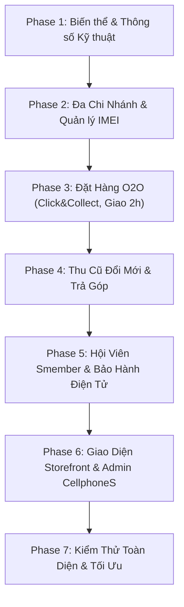

# KẾ HOẠCH TRIỂN KHAI NỀN TẢNG TMĐT BÁN LẺ CÔNG NGHỆ (CELLPHONES MODEL)
> **Dự án:** TechShop Omnichannel Commerce  
> **Nền tảng:** Java 21 | Spring Boot 4.1.1 | Spring Data JPA | MySQL 8.4 / H2 Demo | Thymeleaf & RESTful API  
> **Mục tiêu:** Mở rộng từ TechShop Core MVP hiện tại thành hệ thống TMĐT bán lẻ công nghệ hoàn chỉnh theo mô hình CellphoneS (Omnichannel Retail: O2O, quản lý IMEI/Serial, biến thể công nghệ, Thu cũ đổi mới, Trả góp, Đa chi nhánh và Hội viên Smember).  
> **Đối tượng sử dụng tài liệu:** Các Agent và Kỹ sư phát triển phần mềm tiếp nhận dự án.

---

> **Cập nhật 01/10/2026:** Dấu [x] thể hiện nghiệp vụ thực thi local; khác biệt mục tiêu xem docs/12-implementation-status.md. 58 tests H2/MySQL 8.0.43 và browser E2E. Chưa nghiệm thu Docker/MySQL 8.4, tích hợp ngoài hay thiết bị thật. Task 3.3 còn SMS/email; QR PNG có owner/role đã triển khai; Task 4.2 còn tài chính/BNPL; Task 6.1 có selector mã tỉnh/khu vực đã cấu hình cửa hàng; còn danh mục địa giới toàn quốc/ưu đãi ngân hàng. Đã có pickup giữ/hết hạn/in phiếu, trả góp demo và UI responsive. Kho nhận serial qua text/USB input; camera chưa thử thiết bị. Entity dùng scalar IDs; tồn/IMEI khóa FOR UPDATE; bản đồ là link tọa độ. Checkout chống phản hồi preview cũ/lỗi 409, job hết hạn dùng UTC, nút thanh toán lại dùng đúng transaction đã lưu, admin sửa được sản phẩm INACTIVE. Bảo hành chuẩn 12 tháng/đổi máy 30 ngày đã có; VIP chưa có. V9 thực tế: V9__loyalty_and_warranty.sql. Không đánh dấu Definition of Done production đạt.
## 1. TỔNG QUAN HIỆN TRẠNG & MỤC TIÊU PHÁT TRIỂN

### 1.1. Hiện trạng hệ thống (Current Baseline)
- **Công nghệ nền tảng:** Java 21, Spring Boot 4.1.1, Spring Security, Spring Data JPA, Flyway (đã có migration V1 -> V4), MySQL 8.4 + H2 in-memory cho demo/test.
- **Tính năng đã có:**
  - Xác thực (Authentication/Authorization) với BCrypt, session, CSRF, phân quyền `ROLE_CUSTOMER` và `ROLE_ADMIN`.
  - Quản lý danh mục, sản phẩm cơ bản (đơn biến thể), hình ảnh sản phẩm.
  - Giỏ hàng (Cart) với optimistic locking version, preview giá/phí giao hàng.
  - Quy trình đặt hàng COD, thanh toán giả lập (Mock) và cấu hình VNPay sơ bộ.
  - Quản lý kho đơn lẻ (single-store inventory) với ledger giao dịch (StockMovement).
  - Tra cứu đơn hàng công khai, mã giảm giá (Coupon), đánh giá sản phẩm (Reviews).
  - Bộ kiểm thử hồi quy: **34 tests passing** (`mvn test`).

### 1.2. Khoảng trống cần hoàn thiện theo mô hình CellphoneS (Gaps)
1. **Biến thể sản phẩm đa chiều & Thông số kỹ thuật (Tech Specs & Variants):** Màu sắc, dung lượng (128GB/256GB), phiên bản VN/A, thông số kỹ thuật chuyên sâu và công cụ so sánh sản phẩm.
2. **Hệ thống Đa Chi Nhánh & Quản lý Kho Đa Điểm (Store Locations & Multi-warehouse WMS):** Quản lý tồn kho theo từng cửa hàng, kiểm tra "Cửa hàng còn hàng", điều chuyển nội bộ giữa các kho.
3. **Theo dõi Tồn kho theo Serial / IMEI độc bản (IMEI Lifecycle Tracking):** Quản lý vòng đời từng chiếc máy từ lúc nhập kho, bán ra, gán vào đơn hàng, kích hoạt bảo hành đến xử lý đổi trả.
4. **Mô hình Mua sắm Bán lẻ Đa kênh (Omnichannel Buying Experience):**
   - Đặt online lấy tại cửa hàng gần nhất (Click & Collect / BOPIS).
   - Giao hàng hỏa tốc 2 giờ (Now / Instant Delivery) dựa trên định vị cửa hàng gần khách nhất.
5. **Chương trình Thu cũ Đổi mới (Trade-In / Trợ giá lên đời máy):** Bảng giá thẩm định máy cũ online, trừ tiền chênh lệch trực tiếp vào đơn hàng mới.
6. **Thanh toán Linh hoạt:** Tích hợp trả góp 0% qua thẻ tín dụng và công ty tài chính, hoàn thiện Webhook IPN chuẩn cho VNPay / MoMo.
7. **Hội viên Thân thiết (Smember Loyalty System):** Phân hạng thành viên (S-New, S-Mem, S-Vip), tích lũy điểm thưởng S-Point, chiết khấu động theo hạng thẻ.
8. **Tra cứu & Kích hoạt Bảo hành Điện tử (E-Warranty & RMA):** Tra cứu theo IMEI/Số điện thoại, quy trình bảo hành đổi trả 1-đổi-1 trong 30 ngày.

---

## 2. NGUYÊN TẮC KỸ THUẬT & RÀNG BUỘC BẮT BUỘC CHO AGENT

1. **Bảo toàn tính toàn vẹn (Zero Regression):** Tuyệt đối không làm vỡ **34 unit/integration tests** hiện có. Mọi tính năng mới phải có Flyway migration tuần tự (`V5__...`, `V6__...`) và test case đi kèm.
2. **Cơ chế Khóa & Xử lý Đồng thời (Concurrency & Locking):**
   - Khi xuất kho máy có IMEI: Sử dụng Pessimistic Lock (`PESSIMISTIC_WRITE`) trên bản ghi IMEI để tránh tình trạng 2 đơn hàng hoặc 1 đơn online + 1 khách tại quầy chọn cùng một máy.
   - Thao tác trừ tồn kho tổng phải duy trì qua `StockMovement` (Ledger pattern) để đảm bảo kiểm toán vết.
3. **Kiến trúc Mã nguồn:**
   - Tuân thủ cấu trúc package theo Domain: `vn.techshop.<domain>` (`variant`, `branch`, `imei`, `tradein`, `installment`, `loyalty`, `warranty`).
   - DTOs / Views phải là Java `record` bất biến, không để lộ PasswordHash hoặc Entity trực tiếp ra ngoài API.
   - Transaction boundary rõ ràng tại `@Service`. Tắt `spring.jpa.open-in-view`.
4. **Môi trường kép (H2 Demo & MySQL Production):**
   - Mọi migration MySQL trong `src/main/resources/db/migration/` phải có file tương thích trong `src/main/resources/db/demo/` để chế độ demo và test trên H2 luôn hoạt động mượt mà.

---

## 3. LỘ TRÌNH TRIỂN KHAI CHI TIẾT (PHASED ROADMAP)

---

### GIAI ĐOẠN 1: Chuẩn hóa Biến thể Sản phẩm & Thông số Kỹ thuật (Catalog & Specs)
**Mục tiêu:** Cho phép 1 dòng sản phẩm (ví dụ iPhone 16 Pro Max) có nhiều phiên bản (256GB/512GB/1TB), nhiều màu sắc với giá khác nhau và bảng thông số cấu hình chuẩn công nghệ.

- [x] **Task 1.1: Thiết kế Cơ sở Dữ liệu & Migrations (`V5__product_variants_and_specs.sql`)**
  - Tạo bảng `product_variants`: `id`, `product_id`, `sku_code`, `color_name`, `storage_capacity`, `price`, `original_price`, `status`, `version`.
  - Tạo bảng `product_specifications`: `id`, `product_id`, `spec_group` (Màn hình, CPU, Pin,...), `spec_name`, `spec_value`, `display_order`.
  - Tạo bảng `product_images`: liên kết với từng `variant_id` (chọn màu nào đổi album ảnh tương ứng).
- [x] **Task 1.2: Xây dựng Entities & Repositories**
  - Tạo `ProductVariant`, `ProductSpecification`, `ProductImage` entity.
  - Cập nhật `Product` entity liên kết với tập biến thể.
- [x] **Task 1.3: Service Layer & Business Logic**
  - `ProductVariantService`: Tìm kiếm biến thể theo thuộc tính, quản lý giá theo biến thể.
  - `ProductComparisonService`: Logic lấy thông số 2-3 sản phẩm và chuẩn hóa ma trận so sánh.
- [x] **Task 1.4: API Endpoints & Giao diện**
  - `GET /api/v1/products/{id}/variants`: Danh sách biến thể kèm giá và tình trạng còn hàng.
  - `GET /api/v1/products/compare?ids=1,2,3`: Trả về dữ liệu so sánh thông số kỹ thuật.
- [x] **Task 1.5: Viết Unit & Integration Tests cho Phase 1**
  - Test kiểm tra tính duy nhất của `sku_code` trong biến thể.
  - Test so sánh 2 sản phẩm khác danh mục hoặc cùng danh mục.

---

### GIAI ĐOẠN 2: Quản lý Đa Chi Nhánh & Tồn kho theo Serial/IMEI (Store Network & IMEI)
**Mục tiêu:** Quản lý mạng lưới hàng chục/hàng trăm cửa hàng; mỗi chiếc máy công nghệ được định danh bằng IMEI riêng biệt.

- [x] **Task 2.1: Thiết kế DB & Migrations (`V6__store_branches_and_imei.sql`)**
  - Tạo bảng `store_branches`: `id`, `name`, `code`, `address`, `province_code`, `district_code`, `ward_code`, `phone`, `latitude`, `longitude`, `is_active`.
  - Tạo bảng `branch_inventories`: `id`, `branch_id`, `variant_id`, `quantity`, `reserved_quantity`, `version`.
  - Tạo bảng `product_items_imei`: `id`, `variant_id`, `branch_id`, `imei_number` (UNIQUE), `status` (`IN_STOCK`, `RESERVED`, `SOLD`, `DEFECTIVE`, `RETURNED`), `order_item_id`, `imported_at`, `sold_at`.
- [x] **Task 2.2: Entities & Ledger Quản lý IMEI**
  - `StoreBranch`, `BranchInventory`, `ProductItemImei`.
  - `ImeiHistory` ghi vết mọi lần chuyển trạng thái của IMEI (nhập kho, điều chuyển, bán, hoàn trả).
- [x] **Task 2.3: Nghiệp vụ Kho Đa Điểm (WMS Services)**
  - `BranchInventoryService`:
    - API tra cứu tồn kho theo chi nhánh: `findStoresWithStock(variantId, provinceCode)`.
    - Điều chuyển hàng giữa 2 chi nhánh (`transferStock(fromBranch, toBranch, imeiList)`).
  - `ImeiManagementService`:
    - Nhập kho theo danh sách IMEI (hỗ trợ nhập hàng loạt qua text hoặc file Excel).
    - Khóa giữ IMEI (`reserveImei`) khi đơn hàng được xác nhận đóng gói.
- [x] **Task 2.4: Admin UI / API Quản lý Chi Nhánh & Quét IMEI**
  - Màn hình quản lý danh sách cửa hàng và bản đồ chi nhánh.
  - Giao diện quét mã vạch / IMEI bằng máy quét barcode hoặc camera.
- [x] **Task 2.5: Viết Tests cho Phase 2**
  - Concurrency test: Hai transaction đồng thời cố gắng xuất cùng 1 IMEI -> 1 thành công, 1 nhận lỗi `ImeiAlreadySoldException`.

---

### GIAI ĐOẠN 3: Quy trình Mua sắm Đa kênh O2O (Click & Collect & Giao Siêu Tốc 2h)
**Mục tiêu:** Cung cấp trải nghiệm mua sắm linh hoạt như CellphoneS: Khách nhận máy tại shop gần nhất hoặc giao hàng hỏa tốc trong 2 giờ.

- [x] **Task 3.1: Mở rộng Đơn hàng & Migrations (`V7__omnichannel_orders.sql`)**
  - Bổ sung vào `orders`:
    - `fulfillment_type`: `HOME_DELIVERY_STANDARD`, `HOME_DELIVERY_INSTANT_2H`, `CLICK_AND_COLLECT`.
    - `pickup_branch_id`: Chi nhánh khách hẹn đến lấy (với đơn Click & Collect).
    - `pickup_time`: Thời gian dự kiến khách đến lấy máy.
    - `assigned_branch_id`: Chi nhánh chịu trách nhiệm xuất kho giao hàng (với đơn 2h).
- [x] **Task 3.2: Bộ máy Điều phối Đơn hàng Tự động (Smart Order Routing Engine)**
  - Xây dựng `OrderRoutingService`:
    - Khi khách chọn giao 2h: Tính toán khoảng cách địa lý (khoảng cách Haversine giữa tọa độ khách và tọa độ các chi nhánh) -> Tự động chọn chi nhánh gần nhất có `quantity > 0` để giao.
  - Phí giao hàng động: Tính phí giao 2h theo cước dịch vụ hỏa tốc (Ahamove/Grab API hoặc bảng cước theo km).
- [ ] **Task 3.3: Luồng Khách Đặt Giữ Hàng (BOPIS Flow)**
  - Khách chọn: "Nhận tại cửa hàng [Số 123 Thái Hà, Hà Nội]" -> Hệ thống tạm giữ hàng (Reserved) trong 24 giờ.
  - Hiển thị mã nhận hàng và QR PNG riêng trong đơn (đã làm); gửi SMS/Email cho khách (chưa kết nối dịch vụ).
  - Nhân viên thu ngân tại shop nhập Pickup Code để mở đơn, quét IMEI và in hóa đơn tại quầy.
- [x] **Task 3.4: Viết Tests cho Phase 3**
  - Test tự động routing đơn hàng về đúng chi nhánh lân cận còn hàng.
  - Test hết hạn giữ hàng (Hủy đơn tự động sau 24h nếu khách không đến nhận và hoàn trả tồn kho).

---

### GIAI ĐOẠN 4: Thu Cũ Đổi Mới & Thanh toán Trả Góp (Trade-in & Installments)
**Mục tiêu:** Triển khai 2 vũ khí bán hàng mạnh nhất của chuỗi bán lẻ công nghệ.

- [x] **Task 4.1: Module Thu Cũ Đổi Mới (Trade-in Engine)**
  - Schema (`V8__trade_in_and_installments.sql`):
    - `trade_in_devices`: Danh sách model điện thoại cũ được thu mua (iPhone 11, 12, 13,...).
    - `trade_in_criterias`: Các tiêu chí đánh giá (Loại 1: Đẹp như mới; Loại 2: Xước nhẹ; Loại 3: Màn xước/pin chai; Loại 4: Lỗi chức năng).
    - `trade_in_requests`: Lưu thông tin thẩm định của khách gắn với đơn mua máy mới (`subsidy_amount` - tiền trợ giá).
  - `TradeInService`: Tính giá thu máy cũ tự động + trợ giá lên đời -> trừ thẳng vào tổng tiền thanh toán của đơn hàng.
- [ ] **Task 4.2: Module Trả Góp Đa Phương Thức (Installment Engine)**
  - Bảng `installment_plans`: Ngân hàng, kỳ hạn (3, 6, 9, 12 tháng), lãi suất (0%), phí chuyển đổi.
  - Bảng `installment_applications`: Thông tin đăng ký trả góp qua công ty tài chính (Home Credit / FE Credit) với trạng thái phê duyệt hồ sơ.
  - Bổ sung thanh toán BNPL (Kredivo, Fundiin sandbox/mock).
- [x] **Task 4.3: Viết Tests cho Phase 4**
  - Test tính đúng số tiền thanh toán cuối cùng sau khi khấu trừ tiền máy thu cũ.
  - Test tính bảng tiền trả góp định kỳ hàng tháng chính xác từng đồng.

---

### GIAI ĐOẠN 5: Hệ thống Hội viên Smember & Tra cứu Bảo hành Điện tử (Loyalty & RMA)
**Mục tiêu:** Giữ chân khách hàng với hệ sinh thái điểm thưởng Smember và số hóa quy trình bảo hành theo IMEI.

- [x] **Task 5.1: Hệ sinh thái Hội viên Smember (`V9__loyalty_smember.sql`)**
  - Bảng `member_profiles`: `user_id`, `rank` (`S_NEW`, `S_MEM`, `S_VIP`), `accumulated_spending`, `points_balance`.
  - Bảng `point_transactions`: Lịch sử cộng/trừ điểm thưởng S-Point.
  - Quy tắc nghiệp vụ (`LoyaltyService`):
    - Tích lũy 1% giá trị đơn hàng thành điểm thưởng S-Point (1 điểm = 1.000 VNĐ).
    - Tự động nâng hạng thành viên khi đạt mốc chi tiêu (S-Mem > 10 triệu, S-Vip > 30 triệu).
    - Chiết khấu độc quyền theo hạng hội viên ngay trên giá bán sản phẩm.
- [x] **Task 5.2: Hệ thống Bảo hành Điện tử & Hậu mãi (E-Warranty & RMA)**
  - Bảng `warranty_cards`: `imei_number`, `order_id`, `customer_id`, `start_date`, `end_date`, `warranty_type` (Chính hãng 12 tháng, Bảo hành rơi vỡ VIP).
  - Bảng `repair_tickets`: Quản lý tiếp nhận máy sửa chữa, tiến độ sửa (Đã nhận -> Đang sửa -> Đã xong -> Đã bàn giao).
  - `WarrantyService`:
    - API tra cứu bảo hành công khai: `GET /api/v1/warranty/lookup?query={imei_or_phone}`.
    - Tự động kích hoạt gói bảo hành ngay khi đơn hàng chuyển trạng thái `DELIVERED`.
- [x] **Task 5.3: Viết Tests cho Phase 5**
  - Test tự động cộng điểm và nâng hạng khách hàng sau khi hoàn tất đơn hàng.
  - Test tra cứu bảo hành chính xác ngày bắt đầu và kết thúc theo IMEI.

---

### GIAI ĐOẠN 6: Hoàn thiện Giao diện Storefront & Admin Portal theo Phong cách CellphoneS
**Mục tiêu:** Giao diện người dùng hiện đại, sắc thái đỏ - trắng công nghệ đặc trưng, hiển thị thông tin trực quan, thao tác nhanh mượt.

- [ ] **Task 6.1: Giao diện Khách hàng (Thymeleaf + Modern CSS/JS)**
  - **Header công nghệ:** Thanh tìm kiếm gợi ý tức thì, chọn tỉnh thành xem tồn kho cửa hàng gần nhất, nút hotline, tra cứu bảo hành, tài khoản Smember.
  - **Trang chi tiết sản phẩm chuẩn CellphoneS:**
    - Box chọn dung lượng & chọn màu sắc có nhảy giá tức thì.
    - Hộp chọn ưu đãi thanh toán (giảm thêm khi qua VNPay, giảm hội viên Smember).
    - Box "Xem cửa hàng có sẵn hàng" theo Tỉnh/Huyện.
    - Tab Thông số kỹ thuật chuyên sâu và box Thẩm định giá Thu cũ đổi mới.
  - **Trang Đặt hàng (Checkout):** Tabs chuyển đổi rõ ràng giữa "Giao hàng tận nơi (Giao 2h)" và "Nhận tại cửa hàng".
- [x] **Task 6.2: Giao diện Quản trị Cửa hàng (Admin & Store Staff Portal)**
  - Quản trị tồn kho theo chi nhánh và công cụ quét mã IMEI xuất kho.
  - Màn hình tiếp nhận đơn Click & Collect cho nhân viên chi nhánh xử lý.
  - Dashboard doanh thu phân tích chi tiết theo kênh (Online vs Tại cửa hàng) và theo chi nhánh.

---

### GIAI ĐOẠN 7: Kiểm thử Tổng thể, Tối ưu Hiệu năng & Hoàn tất Nghiệm thu
- [x] **Task 7.1: Bộ Kiểm thử Tích hợp Toàn diện (Comprehensive E2E Tests)**
  - Kịch bản 1: Mua online giao 2h -> Hệ thống route đơn -> Nhân viên gán IMEI -> Giao thành công -> Kích hoạt bảo hành -> Tích điểm Smember.
  - Kịch bản 2: Khách đặt Click & Collect -> Đến shop kiểm tra -> Quét IMEI thu tiền tại quầy.
  - Kịch bản 3: Mua máy mới kèm Thu cũ đổi mới -> Kiểm tra trừ tiền trợ giá chuẩn xác.
- [x] **Task 7.2: Kiểm tra Tải & Race Conditions (Stress Testing)**
  - Kiểm tra 100 request đồng thời tranh mua 1 chiếc máy cuối cùng có IMEI cụ thể -> Đảm bảo chỉ 1 giao dịch thành công.
- [x] **Task 7.3: Cập nhật Toàn bộ Tài liệu Dự án**
  - Cập nhật `README.md` hướng dẫn chạy với dữ liệu mẫu chi nhánh & IMEI.
  - Bổ sung tài liệu OpenAPI / Swagger cho toàn bộ các endpoints mới.
  - Cập nhật `docs/12-implementation-status.md` xác nhận hoàn thành đầy đủ các tiêu chí.

---

## 4. TIÊU CHÍ NGHIỆM THU TỔNG THỂ (DEFINITION OF DONE)

Một Agent được coi là hoàn thành nhiệm vụ khi đáp ứng đủ các tiêu chuẩn sau:
1. `mvn verify` chạy thành công, toàn bộ tests cũ (34 tests) và các tests mới đều **PASS (0 failures, 0 errors)**.
2. Ứng dụng khởi chạy thành công ở cả 2 chế độ:
   - Chế độ Demo: `./mvnw spring-boot:run -Dspring-boot.run.profiles=demo` (có sẵn dữ liệu mẫu chi nhánh, sản phẩm biến thể, IMEI, hội viên).
   - Chế độ Production MySQL qua Docker Compose.
3. Không tồn tại lỗi rò rỉ dữ liệu hoặc concurrency issue trong việc gán và xuất bán IMEI.
4. Giao diện người dùng trực quan, responsive mượt mà trên cả máy tính và điện thoại di động.
